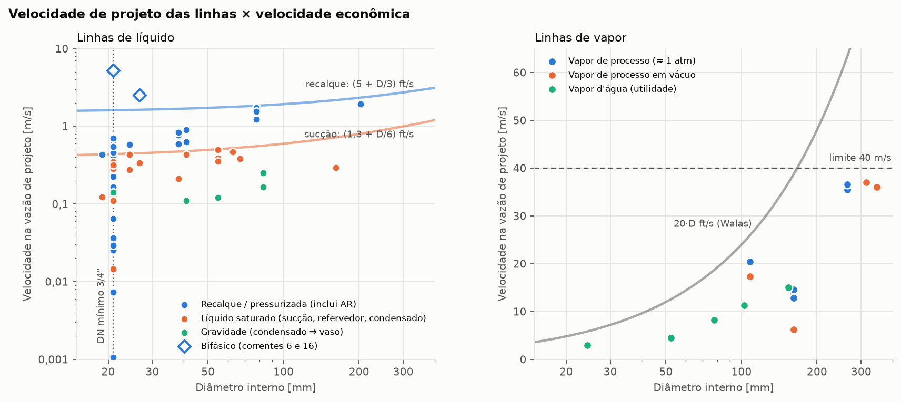
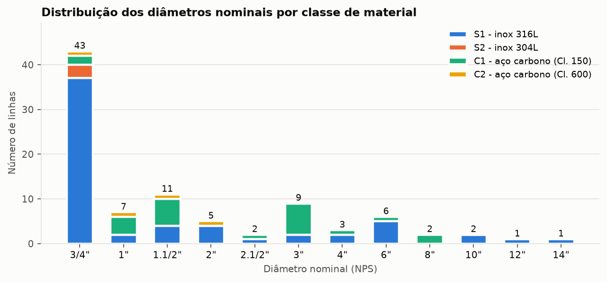

# Memorial de Cálculo — Dimensionamento das Tubulações do P&ID

**Planta de álcool benzílico — Área 2 (hidrólise do acetato de benzila) · Projeto Base · 2,37 t/d**

| Item | Descrição |
| --- | --- |
| Documento | MC-TUB-001 · Revisão 0 |
| Disciplina | Projetos de Indústrias Químicas I — UNESP, Instituto de Química (Araraquara) |
| Base de dados | Aspen Plus V15 (Projeto Base, NRTL-HOC) e relatório PIQ I — Tabelas 4 a 7, 26, 29 e 30; Anexos 7, 9, 10, 13 e 16 |
| Método | Velocidade (vazão) econômica — heurísticas de Walas (1988) e Turton et al. (2018), com verificação hidráulica e mecânica |
| Arquivos gerados | `resultados/lista_de_linhas.xlsx` e `.csv` (lista de linhas completa), figuras em `resultados/` |
| Gerado em | 03/10/2026 por `tubulacoes_bzoh/run_dimensionamento.py` |

## Resultado

Foram dimensionadas **92 linhas**: 34 correntes do PFD, 30 linhas auxiliares das colunas T-101 a T-105 (vapor de topo, condensado, sucção e recalque de refluxo, alimentação e retorno dos refervedores) e 28 linhas de utilidades (água de resfriamento, vapor e condensado).

- **Materiais:** inox **AISI 316L** (classe S1) em 61 linhas de processo, por causa do ácido acético e do meio hidrolítico; inox **AISI 304L** (S2) nas 3 alimentações limpas a 25 °C (água e acetato de benzila); **aço carbono ASTM A106 Gr. B** nas 28 linhas de utilidades (C1, Classe 150: 24 linhas; C2, Classe 600, vapor de alta: 4 linhas).
- **Diâmetros:** de 3/4" a 14". Como a planta é pequena (vazões de líquido de processo abaixo de 1 m³/h), **43 linhas ficam no diâmetro mínimo de 3/4"**: o diâmetro econômico delas é menor que 3/4", e o diâmetro mínimo da especificação é que governa.
- **Linhas de maior diâmetro:** `14"-PV-111-S1` (Vapor de topo da T-101); `12"-PV-116-S1` (Retorno de vapor do refervedor da T-101); `10"-PV-141-S1` (Vapor de topo da T-104); `10"-PV-146-S1` (Retorno de vapor do refervedor da T-104); `8"-AR-215-C1` (Água de resfriamento - suprimento - Condensador T-104 (2.005,2 kW)); `8"-AR-216-C1` (Água de resfriamento - retorno - Condensador T-104 (2.005,2 kW)).

**Formato do tag:** `NPS-código do fluido-número da linha-classe de material`. Os números 001 a 034 são as correntes do PFD (mesma numeração do Aspen), 1*k*1 a 1*k*6 são as linhas auxiliares da coluna T-10*k*, 2xx é água de resfriamento, 30*k* é vapor e 40*k* é condensado do refervedor da T-10*k*. Códigos de fluido: **P** = processo - líquido; **PV** = processo - vapor; **PM** = processo - bifásico; **AR** = água de resfriamento; **VB / VM / VA** = vapor d'água de baixa / média / alta pressão; **CD** = condensado de vapor.

### Lista de linhas — Processo (PFD)

| Tag (P&ID) | Serviço | De → Para | Fase | Material (classe) | NPS | Schedule | DI [mm] | v proj. [m/s] | Critério |
| --- | --- | --- | --- | --- | :---: | :---: | ---: | ---: | --- |
| `3/4"-P-001-S2` | Água de processo (alimentação) | Limite de bateria → M-101 | Líquido | S2 - Aço inoxidável AISI 304L | **3/4"** | Sch 40S | 20,9 | 0,025 | DN mínimo |
| `3/4"-P-002-S1` | Ácido acético glacial (alimentação) | Limite de bateria → M-101 | Líquido | S1 - Aço inoxidável AISI 316L | **3/4"** | Sch 40S | 20,9 | 0,065 | DN mínimo |
| `3/4"-P-003-S2` | Acetato de benzila (alimentação da Área 1) | Área 1 → M-101 | Líquido | S2 - Aço inoxidável AISI 304L | **3/4"** | Sch 40S | 20,9 | 0,14 | DN mínimo |
| `3/4"-P-004-S2` | Água (alimentação da M-104) | Limite de bateria → M-104 | Líquido | S2 - Aço inoxidável AISI 304L | **3/4"** | Sch 40S | 20,9 | 0,0011 | DN mínimo |
| `3/4"-P-005-S1` | Mistura das alimentações frescas | M-101 → M-102 | Líquido | S1 - Aço inoxidável AISI 316L | **3/4"** | Sch 40S | 20,9 | 0,23 | DN mínimo |
| `1"-PM-006-S1` | Alimentação do reator R-101 (com reciclos) | M-102 → R-101 | Bifásico | S1 - Aço inoxidável AISI 316L | **1"** | Sch 40S | 26,6 | 2,5 | ΔP econômico |
| `3/4"-P-007-S1` | Efluente do reator R-101 | R-101 → M-103 | Líquido | S1 - Aço inoxidável AISI 316L | **3/4"** | Sch 40S | 20,9 | 0,61 | DN mínimo |
| `3/4"-P-008-S1` | Efluente do reator + reciclo orgânico (30) | M-103 → E-101 | Líquido | S1 - Aço inoxidável AISI 316L | **3/4"** | Sch 40S | 20,9 | 0,61 | DN mínimo |
| `3/4"-P-009-S1` | Efluente resfriado no E-101 | E-101 → P-101 | Líquido | S1 - Aço inoxidável AISI 316L | **3/4"** | Sch 40S | 20,9 | 0,58 | DN mínimo |
| `3/4"-P-010-S1` | Alimentação da T-101 (após redução de pressão) | P-101 → T-101 | Líquido | S1 - Aço inoxidável AISI 316L | **3/4"** | Sch 40S | 20,9 | 0,58 | DN mínimo |
| `3/4"-P-011-S1` | Destilado da T-101 (água / ácido acético) | T-101 → P-102 | Líquido | S1 - Aço inoxidável AISI 316L | **3/4"** | Sch 40S | 20,9 | 0,27 | DN mínimo |
| `3/4"-P-012-S1` | Fundo da T-101 (acetato + álcool benzílico) | T-101 → P-103 | Líquido | S1 - Aço inoxidável AISI 316L | **3/4"** | Sch 40S | 20,9 | 0,35 | DN mínimo |
| `3/4"-P-013-S1` | Alimentação da T-103 | P-103 → T-103 | Líquido | S1 - Aço inoxidável AISI 316L | **3/4"** | Sch 40S | 20,9 | 0,35 | DN mínimo |
| `3/4"-P-014-S1` | Destilado da T-103 (rico em álcool benzílico) | T-103 → M-104 | Líquido | S1 - Aço inoxidável AISI 316L | **3/4"** | Sch 40S | 20,9 | 0,16 | DN mínimo |
| `3/4"-P-015-S1` | Fundo da T-103 - reciclo de acetato ao reator | T-103 → M-102 | Líquido | S1 - Aço inoxidável AISI 316L | **3/4"** | Sch 40S | 20,9 | 0,22 | DN mínimo |
| `3/4"-PM-016-S1` | Destilado da T-103 + água (bifásico) | M-104 → M-105 | Bifásico | S1 - Aço inoxidável AISI 316L | **3/4"** | Sch 40S | 20,9 | 5,3 | DN mínimo |
| `3/4"-P-017-S1` | Alimentação da T-104 (azeotrópica) | M-105 → T-104 | Líquido | S1 - Aço inoxidável AISI 316L | **3/4"** | Sch 40S | 20,9 | 0,70 | DN mínimo |
| `3/4"-P-018-S1` | Destilado da T-104 (água + acetato de benzila) | T-104 → E-103 | Líquido | S1 - Aço inoxidável AISI 316L | **3/4"** | Sch 40S | 20,9 | 0,49 | DN mínimo |
| `3/4"-P-019-S1` | Fundo da T-104 (álcool benzílico bruto) | T-104 → E-102 | Líquido | S1 - Aço inoxidável AISI 316L | **3/4"** | Sch 40S | 20,9 | 0,24 | DN mínimo |
| `3/4"-P-020-S1` | Fundo da T-104 resfriado no E-102 | E-102 → P-104 | Líquido | S1 - Aço inoxidável AISI 316L | **3/4"** | Sch 40S | 20,9 | 0,23 | DN mínimo |
| `3/4"-P-021-S1` | Alimentação da T-105 (após redução de pressão) | P-104 → T-105 | Líquido | S1 - Aço inoxidável AISI 316L | **3/4"** | Sch 40S | 20,9 | 0,23 | DN mínimo |
| `3/4"-P-022-S1` | Destilado da T-105 (água + álcool benzílico) | T-105 → P-105 | Líquido | S1 - Aço inoxidável AISI 316L | **3/4"** | Sch 40S | 20,9 | 0,13 | DN mínimo |
| `3/4"-P-023-S1` | Fundo da T-105 - álcool benzílico 99,9 % | T-105 → P-106 | Líquido | S1 - Aço inoxidável AISI 316L | **3/4"** | Sch 40S | 20,9 | 0,11 | DN mínimo |
| `3/4"-P-024-S1` | Destilado da T-105 - reciclo à M-105 | P-105 → M-105 | Líquido | S1 - Aço inoxidável AISI 316L | **3/4"** | Sch 40S | 20,9 | 0,13 | DN mínimo |
| `3/4"-P-025-S1` | Fase orgânica do decantador V-101 | V-101 → S-101 | Líquido | S1 - Aço inoxidável AISI 316L | **3/4"** | Sch 40S | 20,9 | 0,036 | DN mínimo |
| `3/4"-P-026-S1` | Fase aquosa do V-101 - reciclo à M-105 | V-101 → M-105 | Líquido | S1 - Aço inoxidável AISI 316L | **3/4"** | Sch 40S | 20,9 | 0,42 | DN mínimo |
| `3/4"-P-027-S1` | Alimentação da T-102 (destilado da T-101) | P-102 → T-102 | Líquido | S1 - Aço inoxidável AISI 316L | **3/4"** | Sch 40S | 20,9 | 0,27 | DN mínimo |
| `3/4"-P-028-S1` | Destilado da T-102 (água) | T-102 → M-106 | Líquido | S1 - Aço inoxidável AISI 316L | **3/4"** | Sch 40S | 20,9 | 0,14 | DN mínimo |
| `3/4"-P-029-S1` | Fundo da T-102 - ácido acético subproduto (≈ 90 %) | T-102 → Tancagem | Líquido | S1 - Aço inoxidável AISI 316L | **3/4"** | Sch 40S | 20,9 | 0,15 | DN mínimo |
| `3/4"-P-030-S1` | Fase orgânica - reciclo à M-103 | S-101 → M-103 | Líquido | S1 - Aço inoxidável AISI 316L | **3/4"** | Sch 40S | 20,9 | 0,0073 | DN mínimo |
| `3/4"-P-031-S1` | Fase orgânica - à M-106 | S-101 → M-106 | Líquido | S1 - Aço inoxidável AISI 316L | **3/4"** | Sch 40S | 20,9 | 0,029 | DN mínimo |
| `3/4"-P-032-S1` | Reciclo ao reator (M-106 → M-102) | M-106 → M-102 | Líquido | S1 - Aço inoxidável AISI 316L | **3/4"** | Sch 40S | 20,9 | 0,17 | DN mínimo |
| `3/4"-P-033-S1` | Destilado da T-104 resfriado (E-103) → decantador | E-103 → V-101 | Líquido | S1 - Aço inoxidável AISI 316L | **3/4"** | Sch 40S | 20,9 | 0,46 | DN mínimo |
| `3/4"-P-034-S1` | Álcool benzílico produto → tancagem | P-106 → Tancagem | Líquido | S1 - Aço inoxidável AISI 316L | **3/4"** | Sch 40S | 20,9 | 0,11 | DN mínimo |

### Lista de linhas — Colunas (auxiliares)

| Tag (P&ID) | Serviço | De → Para | Fase | Material (classe) | NPS | Schedule | DI [mm] | v proj. [m/s] | Critério |
| --- | --- | --- | --- | --- | :---: | :---: | ---: | ---: | --- |
| `14"-PV-111-S1` | Vapor de topo da T-101 | T-101 (topo) → Condensador T-101 | Vapor | S1 - Aço inoxidável AISI 316L | **14"** | Sch 10S | 346,0 | 36 | ΔP em vácuo |
| `2"-P-112-S1` | Condensado total da T-101 | Condensador T-101 → Vaso de refluxo T-101 | Líquido | S1 - Aço inoxidável AISI 316L | **2"** | Sch 10S | 54,8 | 0,12 | Autoventilação |
| `1"-P-113-S1` | Sucção da bomba de refluxo da T-101 | Vaso de refluxo T-101 → Bomba de refluxo T-101 | Líquido | S1 - Aço inoxidável AISI 316L | **1"** | Sch 40S | 26,6 | 0,34 | Velocidade econômica |
| `3/4"-P-114-S1` | Refluxo da T-101 | Bomba de refluxo T-101 → T-101 (topo) | Líquido | S1 - Aço inoxidável AISI 316L | **3/4"** | Sch 40S | 20,9 | 0,55 | DN mínimo |
| `2"-P-115-S1` | Alimentação do refervedor da T-101 | T-101 (fundo) → Refervedor T-101 | Líquido | S1 - Aço inoxidável AISI 316L | **2"** | Sch 10S | 54,8 | 0,39 | Velocidade econômica |
| `12"-PV-116-S1` | Retorno de vapor do refervedor da T-101 | Refervedor T-101 → T-101 (fundo) | Vapor | S1 - Aço inoxidável AISI 316L | **12"** | Sch 10S | 314,7 | 37 | ΔP em vácuo |
| `4"-PV-121-S1` | Vapor de topo da T-102 | T-102 (topo) → Condensador T-102 | Vapor | S1 - Aço inoxidável AISI 316L | **4"** | Sch 10S | 108,2 | 20 | Velocidade econômica |
| `1.1/2"-P-122-S1` | Condensado total da T-102 | Condensador T-102 → Vaso de refluxo T-102 | Líquido | S1 - Aço inoxidável AISI 316L | **1.1/2"** | Sch 40S | 40,9 | 0,11 | Autoventilação |
| `3/4"-P-123-S1` | Sucção da bomba de refluxo da T-102 | Vaso de refluxo T-102 → Bomba de refluxo T-102 | Líquido | S1 - Aço inoxidável AISI 316L | **3/4"** | Sch 40S | 20,9 | 0,29 | DN mínimo |
| `3/4"-P-124-S1` | Refluxo da T-102 | Bomba de refluxo T-102 → T-102 (topo) | Líquido | S1 - Aço inoxidável AISI 316L | **3/4"** | Sch 40S | 20,9 | 0,29 | DN mínimo |
| `1.1/2"-P-125-S1` | Alimentação do refervedor da T-102 | T-102 (fundo) → Refervedor T-102 | Líquido | S1 - Aço inoxidável AISI 316L | **1.1/2"** | Sch 40S | 40,9 | 0,43 | Velocidade econômica |
| `6"-PV-126-S1` | Retorno de vapor do refervedor da T-102 | Refervedor T-102 → T-102 (fundo) | Vapor | S1 - Aço inoxidável AISI 316L | **6"** | Sch 10S | 161,5 | 14 | Velocidade econômica |
| `6"-PV-131-S1` | Vapor de topo da T-103 | T-103 (topo) → Condensador T-103 | Vapor | S1 - Aço inoxidável AISI 316L | **6"** | Sch 10S | 161,5 | 13 | Velocidade econômica |
| `3"-P-132-S1` | Condensado total da T-103 | Condensador T-103 → Vaso de refluxo T-103 | Líquido | S1 - Aço inoxidável AISI 316L | **3"** | Sch 10S | 82,8 | 0,16 | Autoventilação |
| `2"-P-133-S1` | Sucção da bomba de refluxo da T-103 | Vaso de refluxo T-103 → Bomba de refluxo T-103 | Líquido | S1 - Aço inoxidável AISI 316L | **2"** | Sch 10S | 54,8 | 0,35 | Velocidade econômica |
| `1.1/2"-P-134-S1` | Refluxo da T-103 | Bomba de refluxo T-103 → T-103 (topo) | Líquido | S1 - Aço inoxidável AISI 316L | **1.1/2"** | Sch 40S | 40,9 | 0,63 | ΔP econômico |
| `2.1/2"-P-135-S1` | Alimentação do refervedor da T-103 | T-103 (fundo) → Refervedor T-103 | Líquido | S1 - Aço inoxidável AISI 316L | **2.1/2"** | Sch 10S | 66,9 | 0,38 | Velocidade econômica |
| `6"-PV-136-S1` | Retorno de vapor do refervedor da T-103 | Refervedor T-103 → T-103 (fundo) | Vapor | S1 - Aço inoxidável AISI 316L | **6"** | Sch 10S | 161,5 | 15 | Velocidade econômica |
| `10"-PV-141-S1` | Vapor de topo da T-104 | T-104 (topo) → Condensador T-104 | Vapor | S1 - Aço inoxidável AISI 316L | **10"** | Sch 10S | 264,7 | 35 | Velocidade econômica |
| `3"-P-142-S1` | Condensado total da T-104 | Condensador T-104 → Vaso de refluxo T-104 | Líquido | S1 - Aço inoxidável AISI 316L | **3"** | Sch 10S | 82,8 | 0,25 | Autoventilação |
| `2"-P-143-S1` | Sucção da bomba de refluxo da T-104 | Vaso de refluxo T-104 → Bomba de refluxo T-104 | Líquido | S1 - Aço inoxidável AISI 316L | **2"** | Sch 10S | 54,8 | 0,50 | Velocidade econômica |
| `1.1/2"-P-144-S1` | Refluxo da T-104 | Bomba de refluxo T-104 → T-104 (topo) | Líquido | S1 - Aço inoxidável AISI 316L | **1.1/2"** | Sch 40S | 40,9 | 0,90 | Velocidade econômica |
| `6"-P-145-S1` | Alimentação do refervedor da T-104 | T-104 (fundo) → Refervedor T-104 | Líquido | S1 - Aço inoxidável AISI 316L | **6"** | Sch 10S | 161,5 | 0,29 | Velocidade econômica |
| `10"-PV-146-S1` | Retorno de vapor do refervedor da T-104 | Refervedor T-104 → T-104 (fundo) | Vapor | S1 - Aço inoxidável AISI 316L | **10"** | Sch 10S | 264,7 | 37 | Velocidade econômica |
| `6"-PV-151-S1` | Vapor de topo da T-105 | T-105 (topo) → Condensador T-105 | Vapor | S1 - Aço inoxidável AISI 316L | **6"** | Sch 10S | 161,5 | 6,2 | ΔP em vácuo |
| `3/4"-P-152-S1` | Condensado total da T-105 | Condensador T-105 → Vaso de refluxo T-105 | Líquido | S1 - Aço inoxidável AISI 316L | **3/4"** | Sch 40S | 20,9 | 0,14 | DN mínimo |
| `3/4"-P-153-S1` | Sucção da bomba de refluxo da T-105 | Vaso de refluxo T-105 → Bomba de refluxo T-105 | Líquido | S1 - Aço inoxidável AISI 316L | **3/4"** | Sch 40S | 20,9 | 0,015 | DN mínimo |
| `3/4"-P-154-S1` | Refluxo da T-105 | Bomba de refluxo T-105 → T-105 (topo) | Líquido | S1 - Aço inoxidável AISI 316L | **3/4"** | Sch 40S | 20,9 | 0,015 | DN mínimo |
| `3/4"-P-155-S1` | Alimentação do refervedor da T-105 | T-105 (fundo) → Refervedor T-105 | Líquido | S1 - Aço inoxidável AISI 316L | **3/4"** | Sch 40S | 20,9 | 0,32 | DN mínimo |
| `4"-PV-156-S1` | Retorno de vapor do refervedor da T-105 | Refervedor T-105 → T-105 (fundo) | Vapor | S1 - Aço inoxidável AISI 316L | **4"** | Sch 10S | 108,2 | 17 | Velocidade econômica |

### Lista de linhas — Utilidades

| Tag (P&ID) | Serviço | De → Para | Fase | Material (classe) | NPS | Schedule | DI [mm] | v proj. [m/s] | Critério |
| --- | --- | --- | --- | --- | :---: | :---: | ---: | ---: | --- |
| `3/4"-AR-201-C1` | Água de resfriamento - suprimento - R-101 (3,9 kW) | Rede de AR → R-101 | Líquido | C1 - Aço carbono ASTM A106 Gr. B | **3/4"** | Sch 80 | 18,9 | 0,43 | DN mínimo |
| `3/4"-AR-202-C1` | Água de resfriamento - retorno - R-101 (3,9 kW) | R-101 → Rede de AR | Líquido | C1 - Aço carbono ASTM A106 Gr. B | **3/4"** | Sch 80 | 18,9 | 0,43 | DN mínimo |
| `1.1/2"-AR-203-C1` | Água de resfriamento - suprimento - E-101 (21,6 kW) | Rede de AR → E-101 | Líquido | C1 - Aço carbono ASTM A106 Gr. B | **1.1/2"** | Sch 80 | 38,1 | 0,59 | ΔP econômico |
| `1.1/2"-AR-204-C1` | Água de resfriamento - retorno - E-101 (21,6 kW) | E-101 → Rede de AR | Líquido | C1 - Aço carbono ASTM A106 Gr. B | **1.1/2"** | Sch 80 | 38,1 | 0,59 | ΔP econômico |
| `1"-AR-205-C1` | Água de resfriamento - suprimento - E-102 (8,7 kW) | Rede de AR → E-102 | Líquido | C1 - Aço carbono ASTM A106 Gr. B | **1"** | Sch 80 | 24,3 | 0,58 | ΔP econômico |
| `1"-AR-206-C1` | Água de resfriamento - retorno - E-102 (8,7 kW) | E-102 → Rede de AR | Líquido | C1 - Aço carbono ASTM A106 Gr. B | **1"** | Sch 80 | 24,3 | 0,59 | ΔP econômico |
| `1.1/2"-AR-207-C1` | Água de resfriamento - suprimento - E-103 (28,2 kW) | Rede de AR → E-103 | Líquido | C1 - Aço carbono ASTM A106 Gr. B | **1.1/2"** | Sch 80 | 38,1 | 0,77 | Velocidade econômica |
| `1.1/2"-AR-208-C1` | Água de resfriamento - retorno - E-103 (28,2 kW) | E-103 → Rede de AR | Líquido | C1 - Aço carbono ASTM A106 Gr. B | **1.1/2"** | Sch 80 | 38,1 | 0,77 | Velocidade econômica |
| `3"-AR-209-C1` | Água de resfriamento - suprimento - Condensador T-101 (264,3 kW) | Rede de AR → Condensador T-101 | Líquido | C1 - Aço carbono ASTM A106 Gr. B | **3"** | Sch 40 | 77,9 | 1,7 | Velocidade econômica |
| `3"-AR-210-C1` | Água de resfriamento - retorno - Condensador T-101 (264,3 kW) | Condensador T-101 → Rede de AR | Líquido | C1 - Aço carbono ASTM A106 Gr. B | **3"** | Sch 40 | 77,9 | 1,7 | Velocidade econômica |
| `3"-AR-211-C1` | Água de resfriamento - suprimento - Condensador T-102 (188,4 kW) | Rede de AR → Condensador T-102 | Líquido | C1 - Aço carbono ASTM A106 Gr. B | **3"** | Sch 40 | 77,9 | 1,2 | Velocidade econômica |
| `3"-AR-212-C1` | Água de resfriamento - retorno - Condensador T-102 (188,4 kW) | Condensador T-102 → Rede de AR | Líquido | C1 - Aço carbono ASTM A106 Gr. B | **3"** | Sch 40 | 77,9 | 1,2 | Velocidade econômica |
| `3"-AR-213-C1` | Água de resfriamento - suprimento - Condensador T-103 (235,2 kW) | Rede de AR → Condensador T-103 | Líquido | C1 - Aço carbono ASTM A106 Gr. B | **3"** | Sch 40 | 77,9 | 1,5 | Velocidade econômica |
| `3"-AR-214-C1` | Água de resfriamento - retorno - Condensador T-103 (235,2 kW) | Condensador T-103 → Rede de AR | Líquido | C1 - Aço carbono ASTM A106 Gr. B | **3"** | Sch 40 | 77,9 | 1,5 | Velocidade econômica |
| `8"-AR-215-C1` | Água de resfriamento - suprimento - Condensador T-104 (2.005,2 kW) | Rede de AR → Condensador T-104 | Líquido | C1 - Aço carbono ASTM A106 Gr. B | **8"** | Sch 40 | 202,7 | 1,9 | Velocidade econômica |
| `8"-AR-216-C1` | Água de resfriamento - retorno - Condensador T-104 (2.005,2 kW) | Condensador T-104 → Rede de AR | Líquido | C1 - Aço carbono ASTM A106 Gr. B | **8"** | Sch 40 | 202,7 | 1,9 | Velocidade econômica |
| `1.1/2"-AR-217-C1` | Água de resfriamento - suprimento - Condensador T-105 (30,6 kW) | Rede de AR → Condensador T-105 | Líquido | C1 - Aço carbono ASTM A106 Gr. B | **1.1/2"** | Sch 80 | 38,1 | 0,83 | Velocidade econômica |
| `1.1/2"-AR-218-C1` | Água de resfriamento - retorno - Condensador T-105 (30,6 kW) | Condensador T-105 → Rede de AR | Líquido | C1 - Aço carbono ASTM A106 Gr. B | **1.1/2"** | Sch 80 | 38,1 | 0,84 | Velocidade econômica |
| `3"-VM-301-C1` | Vapor de média pressão - Refervedor T-101 (281,8 kW) | Rede de VM → Refervedor T-101 | Vapor | C1 - Aço carbono ASTM A106 Gr. B | **3"** | Sch 40 | 77,9 | 8,2 | ΔP econômico |
| `1"-CD-401-C1` | Condensado de VM - Refervedor T-101 | Refervedor T-101 → Purgador / rede de condensado | Líquido | C1 - Aço carbono ASTM A106 Gr. B | **1"** | Sch 80 | 24,3 | 0,44 | Velocidade econômica |
| `4"-VB-302-C1` | Vapor de baixa pressão - Refervedor T-102 (202,0 kW) | Rede de VB → Refervedor T-102 | Vapor | C1 - Aço carbono ASTM A106 Gr. B | **4"** | Sch 40 | 102,3 | 11 | Velocidade econômica |
| `1"-CD-402-C1` | Condensado de VB - Refervedor T-102 | Refervedor T-102 → Purgador / rede de condensado | Líquido | C1 - Aço carbono ASTM A106 Gr. B | **1"** | Sch 80 | 24,3 | 0,28 | Velocidade econômica |
| `2"-VA-303-C2` | Vapor de alta pressão - Refervedor T-103 (255,2 kW) | Rede de VA → Refervedor T-103 | Vapor | C2 - Aço carbono ASTM A106 Gr. B | **2"** | Sch 40 | 52,5 | 4,5 | ΔP econômico |
| `1.1/2"-CD-403-C2` | Condensado de VA - Refervedor T-103 | Refervedor T-103 → Purgador / rede de condensado | Líquido | C2 - Aço carbono ASTM A106 Gr. B | **1.1/2"** | Sch 80 | 38,1 | 0,21 | Velocidade econômica |
| `6"-VM-304-C1` | Vapor de média pressão - Refervedor T-104 (2.027,6 kW) | Rede de VM → Refervedor T-104 | Vapor | C1 - Aço carbono ASTM A106 Gr. B | **6"** | Sch 40 | 154,1 | 15 | Velocidade econômica |
| `2.1/2"-CD-404-C1` | Condensado de VM - Refervedor T-104 | Refervedor T-104 → Purgador / rede de condensado | Líquido | C1 - Aço carbono ASTM A106 Gr. B | **2.1/2"** | Sch 40 | 62,7 | 0,47 | Velocidade econômica |
| `1"-VA-305-C2` | Vapor de alta pressão - Refervedor T-105 (35,9 kW) | Rede de VA → Refervedor T-105 | Vapor | C2 - Aço carbono ASTM A106 Gr. B | **1"** | Sch 80 | 24,3 | 2,9 | Velocidade econômica |
| `3/4"-CD-405-C2` | Condensado de VA - Refervedor T-105 | Refervedor T-105 → Purgador / rede de condensado | Líquido | C2 - Aço carbono ASTM A106 Gr. B | **3/4"** | Sch 80 | 18,9 | 0,12 | DN mínimo |

Classes de material (detalhes na Seção 6):

| Classe | Material | Tubo | Schedule | Flanges | Aplicação |
| --- | --- | --- | --- | --- | --- |
| S1 | Aço inoxidável AISI 316L | ASTM A312 TP316L (com/sem costura) | ASME B36.19M - Sch 40S até 1.1/2"; Sch 10S a partir de 2" | Flanges ASME B16.5 Classe 150 RF (A182 F316L) | Linhas de processo com ácido acético / meio hidrolítico |
| S2 | Aço inoxidável AISI 304L | ASTM A312 TP304L (com/sem costura) | ASME B36.19M - Sch 40S até 1.1/2"; Sch 10S a partir de 2" | Flanges ASME B16.5 Classe 150 RF (A182 F304L) | Alimentações limpas a 25 °C (água de processo, acetato de benzila) |
| C1 | Aço carbono ASTM A106 Gr. B | ASTM A106 Gr. B sem costura | ASME B36.10M - Sch 80 até 1.1/2"; Sch 40 a partir de 2" | Flanges ASME B16.5 Classe 150 RF (A105) | Água de resfriamento; vapor e condensado de baixa e média pressão |
| C2 | Aço carbono ASTM A106 Gr. B | ASTM A106 Gr. B sem costura | ASME B36.10M - Sch 80 até 1.1/2"; Sch 40 a partir de 2" | Flanges ASME B16.5 Classe 600 RF (A105) | Vapor e condensado de alta pressão (~40 bar a) |

## 1. Objetivo e escopo

Este memorial define o **diâmetro nominal, o schedule e o material** de todas as linhas que aparecem no P&ID da Área 2: as correntes do PFD (Figuras 1 e 2 do relatório), as linhas internas ao sistema de cada coluna, que o PFD do Aspen não mostra, mas o P&ID precisa (condensador, vaso e bomba de refluxo, refervedor kettle), e as conexões de utilidades. O dimensionamento é feito pelo **método da velocidade (vazão) econômica**, verificado por perda de carga, por critérios específicos de cada serviço (vácuo, gravidade, bifásico), por NPSH e pela espessura de parede (ASME B31.3). Ficam fora do escopo o sistema de vácuo (ejetores ou bombas de vácuo, que ainda não estão orçados no relatório), as linhas de alívio (PSV) e o detalhamento isométrico.

## 2. Dados de entrada

| Dado | Fonte |
| --- | --- |
| Vazões, T, P, fase, massa específica, massa molar e composição das 34 correntes | Aspen Plus — *Results Summary/Streams* (planilha `BZOH_BASE_CORRENTES.xlsx`, extraída para `dados/correntes_aspen.csv`) |
| Destilado, refluxo, fundo, boil-up, T de topo/fundo e cargas do condensador e do refervedor | Relatório PIQ I — Tabela 7 e Anexos 7, 9, 10, 13 e 16 (`dados/colunas.csv`) |
| Pressão de operação das colunas | Tabela 26 (T-101: 50 torr; T-105: 100 torr; demais: 1 atm) |
| Cargas dos resfriadores E-101 a E-103 e do reator R-101 | Tabela 6 (`dados/resfriadores.csv`) |
| Níveis de vapor (VB, VM e VA) e água de resfriamento | Tabela 6, utilidades do Aspen/APEA e tabelas de vapor (`dados/utilidades.csv`) |
| Materiais dos equipamentos | Tabela 29 e Seção 4 |
| Cenários de produção (base, +30 % e −30 %) | Tabela 34 |

A tabela de correntes do Aspen não traz viscosidade; ela foi estimada (Seção 5), e a Seção 9.5 mostra que o resultado é pouco sensível a essa estimativa.

## 3. Premissas de projeto

| Premissa | Valor adotado | Justificativa |
| --- | --- | --- |
| Vazão de projeto | Q = 1,30 × Qₙ | Cobre o cenário de produção 30 % acima (Tabela 34), sem trocar tubulação |
| Vazão mínima de verificação | 0,70 × Qₙ | Cenário 30 % abaixo (golfadas em linhas bifásicas) |
| Diâmetro mínimo | 3/4" (DN 20) em todas as classes | Resistência mecânica e suportação em rack; mesmo mínimo do APEA e dos bocais da T-101 (Tabela 19) |
| Diâmetros não usados | 1.1/4", 3.1/2" e 5" | Pouco comerciais (Telles) |
| Comprimento equivalente (trecho reto + acessórios) | 30 m processo; 25 m refluxo; 20 m vapor de topo; 5 m linhas junto à coluna; 40 m AR; 30 m vapor; 10 m condensado | Estimativa sem isométrico; só afeta a ΔP total da linha e o critério de vácuo |
| Água de resfriamento | 25 → 35 °C; cp = 4,18 kJ/(kg·K) | Mesma faixa do condensador da T-101 (Tabela 23) |
| Vapor (saturado) | VB: 125 °C, 2,32 bar a; VM: 175 °C, 8,93 bar a; VA: 250 °C, 39,8 bar a | Utilidades do Aspen/APEA; h_fg das tabelas de vapor |
| Cargas térmicas | Tabela 6 (sem integração energética) | Maior demanda de utilidades (partida, ou rede integrada fora de operação) |
| Fluido nas linhas de vapor | Gás ideal; μ ≈ 1,0 × 10⁻⁵ Pa·s | P ≤ 1 atm |
| Rugosidade absoluta | 0,015 mm (inox); 0,045 mm (aço carbono) | White (Moody) |
| NPSH requerido (pré-seleção) | 2,0 m + margem de 1,0 m | Bombas centrífugas pequenas; confirmar na curva do fabricante |

## 4. Metodologia — método da velocidade (vazão) econômica

### 4.1 Fundamento

O diâmetro econômico minimiza o custo total anual da linha, que soma o custo de capital anualizado da tubulação, crescente com $D$, e o custo da energia de bombeamento, que cai rapidamente com $D$:

$$CTA(D) = (a+b)\,C_{tub}(D) + C_{en}\,\frac{Q\,\Delta P(D)}{\eta}\,t_{op},\qquad \Delta P \propto \frac{f\,L\,\rho\,Q^2}{D^5}$$

Com $C_{tub} \propto D^{n}$, a condição $dCTA/dD = 0$ leva a $D_{ót} \propto Q^{\approx 0{,}45}\rho^{\approx 0{,}13}$ (Peters, Timmerhaus e West, 2003). Como a vazão ótima é $Q = (\pi D^2/4)\,v$, isso equivale a uma **velocidade econômica** que cresce devagar com o diâmetro. Walas (1988) e Turton et al. (2018) resumem esse ótimo em heurísticas por tipo de serviço, com o diâmetro interno $D$ em polegadas:

| Serviço | Velocidade econômica | ΔP econômico |
| --- | --- | --- |
| Líquido — recalque de bomba / linha pressurizada | $v_{ec} = (5 + D/3)$ ft/s | 2,0 psi/100 ft = 45,2 kPa/100 m |
| Líquido — sucção de bomba (e líquido saturado) | $v_{ec} = (1{,}3 + D/6)$ ft/s | 0,4 psi/100 ft = 9,05 kPa/100 m |
| Gás e vapor | $v_{ec} = 20\,D$ ft/s | 0,5 psi/100 ft = 11,3 kPa/100 m |

### 4.2 Critérios complementares por serviço

| Serviço | Regra econômica | Restrições adicionais | Fonte |
| --- | --- | --- | --- |
| Recalque, alimentação de colunas, água de resfriamento | recalque | v ≤ 3 m/s | Walas; Turton; NBR 5626 |
| Sucção de bomba; líquido saturado; condensado antes do purgador; fundo → refervedor | sucção | NPSH: altura estática mínima (Seção 9.2) | Walas; Turton |
| Vapor de processo a ≈ 1 atm; vapor d'água | gás | v ≤ 40 m/s | Walas; Spirax Sarco (vapor saturado 25–40 m/s) |
| Vapor de processo em vácuo (T-101, T-105) | gás | ΔP da linha ≤ 1 % da pressão absoluta; v ≤ 60 m/s | Critério adotado: preservar o vácuo e a carga do condensador |
| Condensado do condensador → vaso de refluxo | — | Autoventilação: $Fr = v/\sqrt{gD} \le 0{,}31$ | Simpson (1968) |
| Bifásico (correntes 6 e 16) | — | $v \le V_e = C/\sqrt{\rho_m}$ (C = 100, unidades US); v ≥ 3 m/s desejável; ΔP ≤ 2,0 psi/100 ft | API RP 14E |

### 4.3 Procedimento de seleção

1. Vazão de projeto $Q = 1{,}30\,Q_n$ (vazão volumétrica nas condições de operação, do Aspen).
2. Diâmetro econômico $D_{ec}$: solução de $Q = \dfrac{\pi D^2}{4}\,v_{ec}(D)$ (ou $D_{min}$ de Simpson, ou o diâmetro da velocidade erosional).
3. Varredura dos diâmetros comerciais da classe, do menor (3/4") para o maior; **adota-se o primeiro que atende a todos os critérios**: $v \le v_{ec}(DI)$, $\Delta P/L$ ≤ limite econômico e as restrições da Seção 4.2.
4. O **critério governante** é a condição que reprovou o diâmetro imediatamente menor; se o adotado é 3/4" e $D_{ec}$ < DI(3/4"), governa o DN mínimo.
5. Verificações: Reynolds, fator de atrito, ΔP, espessura (B31.3), flambagem em vácuo, NPSH e comparação com correlações de diâmetro ótimo e com o APEA.

### 4.4 Equações

- Continuidade e Reynolds: $v = \dfrac{4Q}{\pi D^2}$, $Re = \dfrac{\rho v D}{\mu}$.
- Atrito: laminar ($Re$ < 2300) $f = 64/Re$; turbulento, Colebrook-White $\dfrac{1}{\sqrt f} = -2\log_{10}\!\left(\dfrac{\varepsilon/D}{3{,}7} + \dfrac{2{,}51}{Re\sqrt f}\right)$, com Swamee-Jain como estimativa inicial.
- Darcy-Weisbach: $\dfrac{\Delta P}{L} = f\,\dfrac{1}{D}\,\dfrac{\rho v^2}{2}$.
- Vapores (gás ideal): $Q = \dfrac{\dot n R T}{P}$, $\rho = \dfrac{P\,M}{R T}$; vapor de topo $\dot n_V = D(R+1)$; retorno do refervedor $\dot n_V$ = boil-up; alimentação do refervedor kettle = $B + \dot n_V$ (líquido de fundo).
- Bifásico homogêneo: $\rho_m$ e $Q$ do Aspen; $1/\mu_m = x/\mu_V + (1-x)/\mu_L$ (McAdams).
- Água de resfriamento: $\dot m = |\dot Q|/(c_p\,\Delta T)$; vapor: $\dot m = \dot Q/h_{fg}$.
- NPSH com líquido saturado (vasos de refluxo e fundos de coluna): $NPSH_d = z - h_f - \dfrac{K v^2}{2g}$ ⇒ $z_{min} = NPSH_r + \text{margem} + h_f + \dfrac{0{,}5\,v^2}{2g}$.
- Espessura (ASME B31.3, eq. 3a): $t = \dfrac{P D_e}{2(SEW + PY)}$; $t_{min} = \dfrac{t + c}{1 - 0{,}125}$ (tolerância de fabricação de 12,5 %).
- Flambagem elástica de tubo longo sob vácuo: $P_{cr} = \dfrac{2E}{1-\nu^2}\left(\dfrac{t}{D_e}\right)^3$, com fator de segurança 3.

## 5. Propriedades físicas

A massa específica, a massa molar e a vazão volumétrica de cada corrente vêm diretamente do Aspen (NRTL-HOC). Para as linhas internas das colunas usam-se as propriedades do destilado (topo) e do produto de fundo. A viscosidade do líquido foi estimada pela regra de Arrhenius, $\ln\mu_m = \sum x_i \ln\mu_i$ (frações molares), com os componentes puros:

| Componente | Método | Dado de referência | μ a 25 °C | μ a 100 °C |
| --- | --- | --- | --- | --- |
| Água | Equação de Vogel | — | 0,890 mPa·s | 0,279 mPa·s |
| Ácido acético | Lewis–Squires | 1,056 mPa·s a 25 °C (CRC) | 1,06 mPa·s | 0,365 mPa·s |
| Acetato de benzila | Lewis–Squires | ≈ 2,0 mPa·s a 25 °C (estimativa) | 2,00 mPa·s | 0,585 mPa·s |
| Álcool benzílico | Andrade, ajustada em 2 pontos | 5,47 mPa·s (25 °C) e 2,76 mPa·s (50 °C) (CRC) | 5,47 mPa·s | 0,925 mPa·s |

A correlação de Lewis–Squires, $\mu^{-0{,}2661} = \mu_{ref}^{-0{,}2661} + (T - T_{ref})/233$ (μ em cP, T em K; Poling et al., 2001), extrapola a viscosidade a partir de um único ponto. A incerteza dessas estimativas, de até ±50 %, é coberta pela análise de sensibilidade (Seção 9.5).

## 6. Seleção de materiais

- **S1 — AISI 316L (ASTM A312 TP316L):** praticamente todas as correntes internas contêm ácido acético, ou água e acetato de benzila, que hidrolisam formando ácido. A temperatura chega a 213 °C (fundo da T-103), e o ácido é concentrado (≈ 90 %) a 112 °C na corrente 29. O aço carbono é inaceitável nesse meio. O 316L (com molibdênio e baixo carbono, adequado à soldagem) é o material usual para ácido acético e é o mesmo do reator e das colunas T-101, T-103, T-104 e T-105 (Tabela 29). Este memorial estende a recomendação da Seção 4 do relatório, que pedia 316L nas correntes 11, 27 e 29, a todas as linhas de processo. Há ainda dois motivos de processo: o íon ferro, vindo da corrosão do aço carbono, é trocado pela resina sulfônica DOWEX 50W do R-101 e desativa sítios ácidos; e ele também prejudica a cor e a pureza do álcool benzílico (99,9 %). O teor de contaminantes (ácido fórmico, cloretos) deve ser confirmado, porque eles aceleram a corrosão do 316L em ácido acético quente.
- **S2 — AISI 304L (ASTM A312 TP304L):** alimentações limpas a 25 °C, sem ácido (correntes 1, 3 e 4: água de processo e acetato de benzila puro). O 304L é mais barato que o 316L e mantém a isenção de ferro a montante do catalisador. A corrente 2 (ácido acético glacial) fica em 316L.
- **C1 — aço carbono ASTM A106 Gr. B, Classe 150:** água de resfriamento tratada, vapor de baixa e média pressão e seus condensados; sobre-espessura de corrosão de 1,5 mm.
- **C2 — aço carbono ASTM A106 Gr. B, Classe 600:** vapor de alta (≈ 40 bar a, 250 °C) e condensado. A Classe 150 não atende à pressão de projeto de 45 bar g nessa temperatura.

Schedules: 40S até 1.1/2" e 10S a partir de 2" no inox; 80 até 1.1/2" e 40 a partir de 2" no aço carbono, por robustez mecânica dos pequenos diâmetros. Todos foram verificados pela ASME B31.3 (Seção 9.1). As bombas, que a Tabela 29 especifica com carcaça de aço carbono, devem acompanhar a classe da linha (316 nas linhas ácidas).

## 7. Memorial de cálculo — exemplos resolvidos

Os exemplos abaixo mostram o procedimento completo para um caso de cada tipo; as demais linhas seguem o mesmo cálculo (Seção 8).

### 7.1 Líquido pressurizado — alimentação da T-104 (corrente 17)

**Linha 017 — Alimentação da T-104 (azeotrópica)** (M-105 → T-104); serviço: *Líquido - recalque / linha pressurizada*; classe **S1** (Aço inoxidável AISI 316L).

| Dado | Valor |
| --- | --- |
| Vazão mássica | 649,79 kg/h |
| Temperatura / pressão | 67,7 °C / 101,33 kPa abs |
| Massa específica ρ | 971,8 kg/m³ |
| Viscosidade μ | 0,470 mPa·s |
| Vazão volumétrica normal Qₙ | 0,0001857 m³/s = 0,6686 m³/h |
| Vazão de projeto Q = 1,30 Qₙ | 0,0002415 m³/s |

**Passo 1 — diâmetro econômico.** Com a heurística de Walas/Turton $$v_{ec} = (5 + D/3)\ \text{ft/s}\quad (D\ \text{em polegadas})$$ resolve-se, por iteração, $Q = \dfrac{\pi D^2}{4}\,v_{ec}(D)$:

$$D_{ec} = 13{,}95\ \text{mm} \;(0{,}549\ \text{in}),\qquad v_{ec}(D_{ec}) = 1{,}58\ \text{m/s}$$

**Passo 2 — varredura dos diâmetros comerciais** (ASTM A312 TP316L; ASME B36.19M - Sch 40S até 1.1/2"; Sch 10S a partir de 2"):

| NPS | DI [mm] | v_proj [m/s] | v_ec(DI) [m/s] | ΔP [kPa/100 m] (lim. 45,2) | Verificação |
| --- | --- | --- | --- | --- | --- |
| 3/4" Sch 40S | 20,93 | 0,702 | 1,61 | 28,9 | ✔ adotado |
| 1" Sch 40S | 26,64 | 0,433 | 1,63 | 8,93 | ✔ |

**Passo 3 — verificação hidráulica do diâmetro adotado** (3/4" Sch 40S, DI = 20,93 mm):

- Área: $A = \pi D^2/4 = 0{,}0003441$ m²; $v = Q/A = 0{,}702$ m/s (normal: 0,540 m/s).
- Reynolds: $Re = \rho v D/\mu = 30\,378$ (turbulento); $\varepsilon/D = 0{,}000717$.
- Fator de atrito (Colebrook-White): $f = 0{,}02525$.
- Darcy-Weisbach: $\Delta P/L = f\,\dfrac{1}{D}\,\dfrac{\rho v^2}{2} = 288{,}7$ Pa/m $= 28{,}9$ kPa/100 m; na linha ($L_{eq}$ = 30 m): ΔP = 8,66 kPa.
- Espessura (ASME B31.3, P = 10 bar g): $t_{min} = 0{,}18$ mm ≤ $t_{nom} = 2{,}87$ mm ✔.

**Resultado:** `3/4"-P-017-S1` — critério governante: *DN mínimo da especificação (3/4")*.

### 7.2 Vapor em vácuo — vapor de topo da T-101 (50 torr)

**Linha 111 — Vapor de topo da T-101** (T-101 (topo) → Condensador T-101); serviço: *Vapor de processo em vácuo*; classe **S1** (Aço inoxidável AISI 316L).

| Dado | Valor |
| --- | --- |
| Vazão mássica | 764,06 kg/h |
| Temperatura / pressão | 39,5 °C / 6,67 kPa abs |
| Massa específica ρ | 0,08150 kg/m³ |
| Viscosidade μ | 0,0100 mPa·s |
| Vazão volumétrica normal Qₙ | 2,604 m³/s = 9375 m³/h |
| Vazão de projeto Q = 1,30 Qₙ | 3,385 m³/s |

**Passo 1 — diâmetro econômico.** Com a heurística de Walas/Turton $$v_{ec} = 20\,D\ \text{ft/s}\quad (D\ \text{em polegadas})$$ resolve-se, por iteração, $Q = \dfrac{\pi D^2}{4}\,v_{ec}(D)$:

$$D_{ec} = 261{,}9\ \text{mm} \;(10{,}3\ \text{in}),\qquad v_{ec}(D_{ec}) = 62{,}9\ \text{m/s}$$

**Passo 2 — varredura dos diâmetros comerciais** (ASTM A312 TP316L; ASME B36.19M - Sch 40S até 1.1/2"; Sch 10S a partir de 2"):

| NPS | DI [mm] | v_proj [m/s] | v_ec(DI) [m/s] | ΔP linha (L_eq = 20 m) | Verificação |
| --- | --- | --- | --- | --- | --- |
| 10" Sch 10S | 264,67 | 61,5 | 63,5 | 202,0 Pa (lim. 66,7) | ✘ velocidade máxima, ΔP admissível em vácuo |
| 12" Sch 10S | 314,71 | 43,5 | 75,5 | 87,6 Pa (lim. 66,7) | ✘ ΔP admissível em vácuo |
| 14" Sch 10S | 346,04 | 36,0 | 83,0 | 55,4 Pa (lim. 66,7) | ✔ adotado |
| 16" Sch 10S | 396,84 | 27,4 | 95,2 | 28,7 Pa (lim. 66,7) | ✔ |

**Passo 3 — verificação hidráulica do diâmetro adotado** (14" Sch 10S, DI = 346,04 mm):

- Área: $A = \pi D^2/4 = 0{,}09405$ m²; $v = Q/A = 36{,}0$ m/s (normal: 27,7 m/s).
- Reynolds: $Re = \rho v D/\mu = 101\,520$ (turbulento); $\varepsilon/D = 0{,}0000433$.
- Fator de atrito (Colebrook-White): $f = 0{,}01817$.
- Darcy-Weisbach: $\Delta P/L = f\,\dfrac{1}{D}\,\dfrac{\rho v^2}{2} = 2{,}772$ Pa/m $= 0{,}277$ kPa/100 m; na linha ($L_{eq}$ = 20 m): ΔP = 0,0554 kPa.
- Espessura (ASME B31.3, P = 10 bar g): $t_{min} = 2{,}38$ mm ≤ $t_{nom} = 4{,}78$ mm ✔; vácuo: $P_{cr}/3 = 0{,}23$ MPa ≥ 0,101 MPa ✔.

**Resultado:** `14"-PV-111-S1` — critério governante: *ΔP admissível em vácuo (1 % de P)*.

### 7.3 Vapor a 1 atm — vapor de topo da T-104

**Linha 141 — Vapor de topo da T-104** (T-104 (topo) → Condensador T-104); serviço: *Vapor de processo (≈ 1 atm)*; classe **S1** (Aço inoxidável AISI 316L).

| Dado | Valor |
| --- | --- |
| Vazão mássica | 3.434,96 kg/h |
| Temperatura / pressão | 99,6 °C / 101,33 kPa abs |
| Massa específica ρ | 0,6360 kg/m³ |
| Viscosidade μ | 0,0100 mPa·s |
| Vazão volumétrica normal Qₙ | 1,500 m³/s = 5401 m³/h |
| Vazão de projeto Q = 1,30 Qₙ | 1,950 m³/s |

**Passo 1 — diâmetro econômico.** Com a heurística de Walas/Turton $$v_{ec} = 20\,D\ \text{ft/s}\quad (D\ \text{em polegadas})$$ resolve-se, por iteração, $Q = \dfrac{\pi D^2}{4}\,v_{ec}(D)$:

$$D_{ec} = 217{,}9\ \text{mm} \;(8{,}58\ \text{in}),\qquad v_{ec}(D_{ec}) = 52{,}3\ \text{m/s}$$

**Passo 2 — varredura dos diâmetros comerciais** (ASTM A312 TP316L; ASME B36.19M - Sch 40S até 1.1/2"; Sch 10S a partir de 2"):

| NPS | DI [mm] | v_proj [m/s] | v_ec(DI) [m/s] | ΔP [kPa/100 m] (lim. 11,3) | Verificação |
| --- | --- | --- | --- | --- | --- |
| 6" Sch 10S | 161,48 | 95,2 | 38,8 | 23,9 | ✘ velocidade econômica, perda de carga por 100 m, velocidade máxima |
| 8" Sch 10S | 211,56 | 55,5 | 50,8 | 6,21 | ✘ velocidade econômica, velocidade máxima |
| 10" Sch 10S | 264,67 | 35,5 | 63,5 | 2,05 | ✔ adotado |
| 12" Sch 10S | 314,71 | 25,1 | 75,5 | 0,877 | ✔ |

**Passo 3 — verificação hidráulica do diâmetro adotado** (10" Sch 10S, DI = 264,67 mm):

- Área: $A = \pi D^2/4 = 0{,}05502$ m²; $v = Q/A = 35{,}5$ m/s (normal: 27,3 m/s).
- Reynolds: $Re = \rho v D/\mu = 596\,716$ (turbulento); $\varepsilon/D = 0{,}0000567$.
- Fator de atrito (Colebrook-White): $f = 0{,}01359$.
- Darcy-Weisbach: $\Delta P/L = f\,\dfrac{1}{D}\,\dfrac{\rho v^2}{2} = 20{,}52$ Pa/m $= 2{,}05$ kPa/100 m; na linha ($L_{eq}$ = 20 m): ΔP = 0,410 kPa.
- Espessura (ASME B31.3, P = 10 bar g): $t_{min} = 1{,}83$ mm ≤ $t_{nom} = 4{,}19$ mm ✔.

**Resultado:** `10"-PV-141-S1` — critério governante: *Velocidade econômica*.

### 7.4 Água de resfriamento — condensador da T-104

**Linha 215 — Água de resfriamento - suprimento - Condensador T-104 (2.005,2 kW)** (Rede de AR → Condensador T-104); serviço: *Água de resfriamento (suprimento/retorno)*; classe **C1** (Aço carbono ASTM A106 Gr. B).

| Dado | Valor |
| --- | --- |
| Vazão mássica | 172.697,26 kg/h |
| Temperatura / pressão | 25,0 °C / 400,00 kPa abs |
| Massa específica ρ | 997,1 kg/m³ |
| Viscosidade μ | 0,890 mPa·s |
| Vazão volumétrica normal Qₙ | 0,04811 m³/s = 173,2 m³/h |
| Vazão de projeto Q = 1,30 Qₙ | 0,06255 m³/s |

**Passo 1 — diâmetro econômico.** Com a heurística de Walas/Turton $$v_{ec} = (5 + D/3)\ \text{ft/s}\quad (D\ \text{em polegadas})$$ resolve-se, por iteração, $Q = \dfrac{\pi D^2}{4}\,v_{ec}(D)$:

$$D_{ec} = 187{,}2\ \text{mm} \;(7{,}37\ \text{in}),\qquad v_{ec}(D_{ec}) = 2{,}27\ \text{m/s}$$

**Passo 2 — varredura dos diâmetros comerciais** (ASTM A106 Gr. B sem costura; ASME B36.10M - Sch 80 até 1.1/2"; Sch 40 a partir de 2"):

| NPS | DI [mm] | v_proj [m/s] | v_ec(DI) [m/s] | ΔP [kPa/100 m] (lim. 45,2) | Verificação |
| --- | --- | --- | --- | --- | --- |
| 4" Sch 40 | 102,26 | 7,62 | 1,93 | 477 | ✘ velocidade econômica, perda de carga por 100 m, velocidade máxima |
| 6" Sch 40 | 154,08 | 3,35 | 2,14 | 58,4 | ✘ velocidade econômica, perda de carga por 100 m, velocidade máxima |
| 8" Sch 40 | 202,74 | 1,94 | 2,33 | 14,6 | ✔ adotado |
| 10" Sch 40 | 254,46 | 1,23 | 2,54 | 4,68 | ✔ |

**Passo 3 — verificação hidráulica do diâmetro adotado** (8" Sch 40, DI = 202,74 mm):

- Área: $A = \pi D^2/4 = 0{,}03228$ m²; $v = Q/A = 1{,}94$ m/s (normal: 1,49 m/s).
- Reynolds: $Re = \rho v D/\mu = 439\,838$ (turbulento); $\varepsilon/D = 0{,}000222$.
- Fator de atrito (Colebrook-White): $f = 0{,}01580$.
- Darcy-Weisbach: $\Delta P/L = f\,\dfrac{1}{D}\,\dfrac{\rho v^2}{2} = 145{,}9$ Pa/m $= 14{,}6$ kPa/100 m; na linha ($L_{eq}$ = 40 m): ΔP = 5,84 kPa.
- Espessura (ASME B31.3, P = 10 bar g): $t_{min} = 2{,}67$ mm ≤ $t_{nom} = 8{,}18$ mm ✔.

**Resultado:** `8"-AR-215-C1` — critério governante: *Velocidade econômica*.

### 7.5 Condensado por gravidade — condensador → vaso de refluxo da T-104

**Linha 142 — Condensado total da T-104** (Condensador T-104 → Vaso de refluxo T-104); serviço: *Condensado por gravidade → vaso de refluxo*; classe **S1** (Aço inoxidável AISI 316L).

| Dado | Valor |
| --- | --- |
| Vazão mássica | 3.434,96 kg/h |
| Temperatura / pressão | 99,6 °C / 101,33 kPa abs |
| Massa específica ρ | 918,3 kg/m³ |
| Viscosidade μ | 0,283 mPa·s |
| Vazão volumétrica normal Qₙ | 0,001039 m³/s = 3,741 m³/h |
| Vazão de projeto Q = 1,30 Qₙ | 0,001351 m³/s |

**Passo 1 — diâmetro mínimo autoventilado** (Simpson, 1968): $Fr = v/\sqrt{gD} \le 0{,}31 \Rightarrow D_{min} = \left(\dfrac{4Q}{\pi\sqrt{g}\,Fr_{max}}\right)^{0{,}4}$ $= 79{,}31$ mm.

**Passo 2 — varredura dos diâmetros comerciais** (ASTM A312 TP316L; ASME B36.19M - Sch 40S até 1.1/2"; Sch 10S a partir de 2"):

| NPS | DI [mm] | v_proj [m/s] | Fr (lim. 0,31) | Verificação |
| --- | --- | --- | --- | --- |
| 2" Sch 10S | 54,79 | 0,573 | 0,782 | ✘ autoventilação (Fr > 0,31) |
| 2.1/2" Sch 10S | 66,93 | 0,384 | 0,474 | ✘ autoventilação (Fr > 0,31) |
| 3" Sch 10S | 82,80 | 0,251 | 0,278 | ✔ adotado |
| 4" Sch 10S | 108,20 | 0,147 | 0,143 | ✔ |

**Passo 3 — verificação hidráulica do diâmetro adotado** (3" Sch 10S, DI = 82,80 mm):

- Área: $A = \pi D^2/4 = 0{,}005385$ m²; $v = Q/A = 0{,}251$ m/s (normal: 0,193 m/s).
- Reynolds: $Re = \rho v D/\mu = 67\,396$ (turbulento); $\varepsilon/D = 0{,}000181$.
- Fator de atrito (Colebrook-White): $f = 0{,}02031$.
- Darcy-Weisbach: $\Delta P/L = f\,\dfrac{1}{D}\,\dfrac{\rho v^2}{2} = 7{,}088$ Pa/m $= 0{,}709$ kPa/100 m; na linha ($L_{eq}$ = 5 m): ΔP = 0,0354 kPa.
- Espessura (ASME B31.3, P = 10 bar g): $t_{min} = 0{,}59$ mm ≤ $t_{nom} = 3{,}05$ mm ✔.

**Resultado:** `3"-P-142-S1` — critério governante: *Autoventilação (Simpson, Fr ≤ 0,31)*.

## 8. Tabela de cálculo de todas as linhas

### 8.1 Processo (PFD)

| Linha | Serviço | Qₙ [m³/h] | Q_proj [m³/h] | ρ [kg/m³] | μ [mPa·s] | D_ec [mm] | NPS / DI [mm] | v_proj [m/s] | v_ec [m/s] (ou Fr, Ve) | Re | ΔP [kPa/100 m] | Critério |
| --- | --- | ---: | ---: | ---: | ---: | ---: | ---: | ---: | ---: | ---: | ---: | --- |
| 001 | Recalque | 0,0241 | 0,0314 | 994,0 | 0,890 | 2,69 | 3/4" / 20,9 | 0,0253 | 1,61 | 592 | 0,165 | DN mínimo |
| 002 | Recalque | 0,0615 | 0,0800 | 1073 | 1,06 | 4,28 | 3/4" / 20,9 | 0,0646 | 1,61 | 1.373 | 0,498 | DN mínimo |
| 003 | Recalque | 0,138 | 0,179 | 1051 | 2,00 | 6,40 | 3/4" / 20,9 | 0,145 | 1,61 | 1.593 | 2,12 | DN mínimo |
| 004 | Recalque | 0,00101 | 0,00131 | 994,0 | 0,890 | 0,551 | 3/4" / 20,9 | 0,00106 | 1,61 | 25 | 0,00687 | DN mínimo |
| 005 | Recalque | 0,220 | 0,285 | 1070 | 1,21 | 8,05 | 3/4" / 20,9 | 0,230 | 1,61 | 4.279 | 5,41 | DN mínimo |
| 006 | Bifásico | 3,91 | 5,09 | 144,3 | 0,300 | 13,3 | 1" / 26,6 | 2,53 | Ve = 10,2 | 32.435 | 42,8 | ΔP econômico |
| 007 | Recalque | 0,578 | 0,752 | 976,4 | 0,422 | 13,0 | 3/4" / 20,9 | 0,607 | 1,61 | 29.381 | 21,8 | DN mínimo |
| 008 | Recalque | 0,585 | 0,761 | 977,5 | 0,425 | 13,1 | 3/4" / 20,9 | 0,614 | 1,61 | 29.534 | 22,3 | DN mínimo |
| 009 | Recalque | 0,551 | 0,716 | 1038 | 1,02 | 12,7 | 3/4" / 20,9 | 0,578 | 1,61 | 12.316 | 25,2 | DN mínimo |
| 010 | Recalque | 0,551 | 0,716 | 1038 | 1,02 | 12,7 | 3/4" / 20,9 | 0,578 | 1,61 | 12.325 | 25,2 | DN mínimo |
| 011 | Sucção (vácuo) | 0,262 | 0,340 | 973,6 | 0,717 | 16,7 | 3/4" / 20,9 | 0,275 | 0,438 | 7.798 | 5,96 | DN mínimo |
| 012 | Sucção (vácuo) | 0,332 | 0,431 | 956,3 | 0,482 | 18,8 | 3/4" / 20,9 | 0,348 | 0,438 | 14.445 | 8,13 | DN mínimo |
| 013 | Recalque | 0,332 | 0,431 | 956,2 | 0,482 | 9,88 | 3/4" / 20,9 | 0,348 | 1,61 | 14.467 | 8,13 | DN mínimo |
| 014 | Recalque | 0,154 | 0,200 | 871,4 | 0,188 | 6,75 | 3/4" / 20,9 | 0,161 | 1,61 | 15.652 | 1,56 | DN mínimo |
| 015 | Recalque | 0,212 | 0,275 | 865,1 | 0,158 | 7,91 | 3/4" / 20,9 | 0,222 | 1,61 | 25.518 | 2,67 | DN mínimo |
| 016 | Bifásico | 5,01 | 6,51 | 26,93 | 0,0854 | 9,90 | 3/4" / 20,9 | 5,26 | Ve = 23,5 | 34.716 | 43,8 | DN mínimo |
| 017 | Recalque | 0,669 | 0,869 | 971,8 | 0,470 | 13,9 | 3/4" / 20,9 | 0,702 | 1,61 | 30.378 | 28,9 | DN mínimo |
| 018 | Recalque | 0,465 | 0,604 | 918,3 | 0,283 | 11,7 | 3/4" / 20,9 | 0,488 | 1,61 | 33.139 | 13,0 | DN mínimo |
| 019 | Recalque | 0,229 | 0,298 | 962,6 | 0,557 | 8,22 | 3/4" / 20,9 | 0,240 | 1,61 | 8.690 | 4,39 | DN mínimo |
| 020 | Recalque | 0,215 | 0,280 | 1024 | 1,97 | 7,97 | 3/4" / 20,9 | 0,226 | 1,61 | 2.454 | 5,86 | DN mínimo |
| 021 | Recalque | 0,215 | 0,280 | 1024 | 1,97 | 7,98 | 3/4" / 20,9 | 0,226 | 1,61 | 2.455 | 5,86 | DN mínimo |
| 022 | Sucção (vácuo) | 0,120 | 0,156 | 1017 | 1,36 | 11,5 | 3/4" / 20,9 | 0,126 | 0,438 | 1.961 | 1,25 | DN mínimo |
| 023 | Sucção (vácuo) | 0,105 | 0,136 | 944,3 | 0,514 | 10,7 | 3/4" / 20,9 | 0,110 | 0,438 | 4.219 | 1,09 | DN mínimo |
| 024 | Recalque | 0,120 | 0,156 | 1017 | 1,36 | 5,96 | 3/4" / 20,9 | 0,126 | 1,61 | 1.966 | 1,25 | DN mínimo |
| 025 | Recalque | 0,0347 | 0,0451 | 1044 | 1,49 | 3,22 | 3/4" / 20,9 | 0,0364 | 1,61 | 532 | 0,397 | DN mínimo |
| 026 | Recalque | 0,401 | 0,522 | 979,4 | 0,652 | 10,9 | 3/4" / 20,9 | 0,421 | 1,61 | 13.250 | 12,4 | DN mínimo |
| 027 | Recalque | 0,262 | 0,340 | 973,5 | 0,716 | 8,78 | 3/4" / 20,9 | 0,275 | 1,61 | 7.811 | 5,96 | DN mínimo |
| 028 | Recalque | 0,130 | 0,169 | 903,1 | 0,283 | 6,21 | 3/4" / 20,9 | 0,136 | 1,61 | 9.112 | 1,31 | DN mínimo |
| 029 | Recalque | 0,146 | 0,190 | 937,2 | 0,309 | 6,59 | 3/4" / 20,9 | 0,154 | 1,61 | 9.759 | 1,70 | DN mínimo |
| 030 | Recalque | 0,00694 | 0,00902 | 1044 | 1,49 | 1,44 | 3/4" / 20,9 | 0,00728 | 1,61 | 106 | 0,0794 | DN mínimo |
| 031 | Recalque | 0,0277 | 0,0361 | 1044 | 1,49 | 2,88 | 3/4" / 20,9 | 0,0291 | 1,61 | 426 | 0,318 | DN mínimo |
| 032 | Recalque | 0,158 | 0,205 | 928,2 | 0,317 | 6,84 | 3/4" / 20,9 | 0,166 | 1,61 | 10.147 | 1,93 | DN mínimo |
| 033 | Recalque | 0,436 | 0,567 | 984,5 | 0,659 | 11,3 | 3/4" / 20,9 | 0,458 | 1,61 | 14.307 | 14,5 | DN mínimo |
| 034 | Recalque | 0,105 | 0,136 | 944,2 | 0,513 | 5,58 | 3/4" / 20,9 | 0,110 | 1,61 | 4.227 | 1,09 | DN mínimo |

### 8.2 Colunas (auxiliares)

| Linha | Serviço | Qₙ [m³/h] | Q_proj [m³/h] | ρ [kg/m³] | μ [mPa·s] | D_ec [mm] | NPS / DI [mm] | v_proj [m/s] | v_ec [m/s] (ou Fr, Ve) | Re | ΔP [kPa/100 m] | Critério |
| --- | --- | ---: | ---: | ---: | ---: | ---: | ---: | ---: | ---: | ---: | ---: | --- |
| 111 | Vapor (vácuo) | 9375 | 12187 | 0,08150 | 0,0100 | 262 | 14" / 346,0 | 36,0 | 83,0 | 101.520 | 0,277 | ΔP em vácuo |
| 112 | Gravidade | 0,785 | 1,02 | 973,6 | 0,717 | 42,5 | 2" / 54,8 | 0,120 | Fr = 0,16 | 8.937 | 0,414 | Autoventilação |
| 113 | Sucção (vácuo) | 0,523 | 0,680 | 973,6 | 0,717 | 23,3 | 1" / 26,6 | 0,339 | 0,450 | 12.254 | 6,35 | Velocidade econômica |
| 114 | Recalque | 0,523 | 0,680 | 973,6 | 0,717 | 12,4 | 3/4" / 20,9 | 0,549 | 1,61 | 15.597 | 20,2 | DN mínimo |
| 115 | Alim. refervedor | 2,53 | 3,28 | 956,3 | 0,482 | 48,5 | 2" / 54,8 | 0,387 | 0,506 | 42.039 | 2,95 | Velocidade econômica |
| 116 | Vapor (vácuo) | 7962 | 10351 | 0,2636 | 0,0100 | 248 | 12" / 314,7 | 37,0 | 75,5 | 306.679 | 0,852 | ΔP em vácuo |
| 121 | Vapor | 520 | 676 | 0,6988 | 0,0100 | 99,9 | 4" / 108,2 | 20,4 | 26,0 | 154.409 | 2,34 | Velocidade econômica |
| 122 | Gravidade | 0,402 | 0,523 | 903,1 | 0,283 | 32,5 | 1.1/2" / 40,9 | 0,111 | Fr = 0,17 | 14.432 | 0,388 | Autoventilação |
| 123 | Sucção (saturado) | 0,272 | 0,354 | 903,1 | 0,283 | 17,1 | 3/4" / 20,9 | 0,286 | 0,438 | 19.089 | 4,87 | DN mínimo |
| 124 | Recalque | 0,272 | 0,354 | 903,1 | 0,283 | 8,96 | 3/4" / 20,9 | 0,286 | 1,61 | 19.089 | 4,87 | DN mínimo |
| 125 | Alim. refervedor | 1,58 | 2,06 | 937,2 | 0,309 | 39,1 | 1.1/2" / 40,9 | 0,435 | 0,478 | 53.930 | 4,73 | Velocidade econômica |
| 126 | Vapor | 785 | 1021 | 1,713 | 0,0100 | 115 | 6" / 161,5 | 13,8 | 38,8 | 383.001 | 1,51 | Velocidade econômica |
| 131 | Vapor | 730 | 949 | 2,930 | 0,0100 | 112 | 6" / 161,5 | 12,9 | 38,8 | 609.092 | 2,11 | Velocidade econômica |
| 132 | Gravidade | 2,45 | 3,19 | 871,4 | 0,188 | 67,0 | 3" / 82,8 | 0,165 | Fr = 0,18 | 63.202 | 0,293 | Autoventilação |
| 133 | Sucção (saturado) | 2,30 | 2,99 | 871,4 | 0,188 | 46,5 | 2" / 54,8 | 0,352 | 0,506 | 89.534 | 1,95 | Velocidade econômica |
| 134 | Recalque | 2,30 | 2,99 | 871,4 | 0,188 | 25,5 | 1.1/2" / 40,9 | 0,633 | 1,69 | 119.940 | 8,21 | ΔP econômico |
| 135 | Alim. refervedor | 3,70 | 4,81 | 865,1 | 0,158 | 57,6 | 2.1/2" / 66,9 | 0,379 | 0,530 | 139.276 | 1,69 | Velocidade econômica |
| 136 | Vapor | 825 | 1072 | 3,656 | 0,0100 | 116 | 6" / 161,5 | 14,5 | 38,8 | 858.552 | 3,24 | Velocidade econômica |
| 141 | Vapor | 5401 | 7021 | 0,6360 | 0,0100 | 218 | 10" / 264,7 | 35,5 | 63,5 | 596.716 | 2,05 | Velocidade econômica |
| 142 | Gravidade | 3,74 | 4,86 | 918,3 | 0,283 | 79,3 | 3" / 82,8 | 0,251 | Fr = 0,28 | 67.396 | 0,709 | Autoventilação |
| 143 | Sucção (saturado) | 3,27 | 4,25 | 918,3 | 0,283 | 54,6 | 2" / 54,8 | 0,501 | 0,506 | 89.120 | 4,15 | Velocidade econômica |
| 144 | Recalque | 3,27 | 4,25 | 918,3 | 0,283 | 30,2 | 1.1/2" / 40,9 | 0,900 | 1,69 | 119.386 | 17,5 | Velocidade econômica |
| 145 | Alim. refervedor | 16,5 | 21,5 | 962,6 | 0,557 | 111 | 6" / 161,5 | 0,291 | 0,719 | 81.269 | 0,486 | Velocidade econômica |
| 146 | Vapor | 5570 | 7241 | 2,816 | 0,0100 | 220 | 10" / 264,7 | 36,6 | 63,5 | 2.724.711 | 8,32 | Velocidade econômica |
| 151 | Vapor (vácuo) | 354 | 460 | 0,3835 | 0,0100 | 87,9 | 6" / 161,5 | 6,24 | 38,8 | 38.665 | 0,104 | ΔP em vácuo |
| 152 | Gravidade | 0,133 | 0,174 | 1017 | 1,36 | 20,9 | 3/4" / 20,9 | 0,140 | Fr = 0,31 | 2.188 | 1,40 | DN mínimo |
| 153 | Sucção (vácuo) | 0,0138 | 0,0180 | 1017 | 1,36 | 3,97 | 3/4" / 20,9 | 0,0145 | 0,438 | 227 | 0,145 | DN mínimo |
| 154 | Recalque | 0,0138 | 0,0180 | 1017 | 1,36 | 2,04 | 3/4" / 20,9 | 0,0145 | 1,61 | 227 | 0,145 | DN mínimo |
| 155 | Alim. refervedor | 0,303 | 0,394 | 944,3 | 0,514 | 17,9 | 3/4" / 20,9 | 0,318 | 0,438 | 12.221 | 6,95 | DN mínimo |
| 156 | Vapor (vácuo) | 440 | 573 | 0,4250 | 0,0100 | 94,5 | 4" / 108,2 | 17,3 | 26,0 | 79.543 | 1,15 | Velocidade econômica |

### 8.3 Utilidades

| Linha | Serviço | Qₙ [m³/h] | Q_proj [m³/h] | ρ [kg/m³] | μ [mPa·s] | D_ec [mm] | NPS / DI [mm] | v_proj [m/s] | v_ec [m/s] (ou Fr, Ve) | Re | ΔP [kPa/100 m] | Critério |
| --- | --- | ---: | ---: | ---: | ---: | ---: | ---: | ---: | ---: | ---: | ---: | --- |
| 201 | Água de resfriamento | 0,334 | 0,434 | 997,1 | 0,890 | 9,91 | 3/4" / 18,9 | 0,430 | 1,60 | 9.099 | 17,1 | DN mínimo |
| 202 | Água de resfriamento | 0,335 | 0,435 | 994,1 | 0,718 | 9,92 | 3/4" / 18,9 | 0,432 | 1,60 | 11.277 | 16,5 | DN mínimo |
| 203 | Água de resfriamento | 1,87 | 2,42 | 997,1 | 0,890 | 23,0 | 1.1/2" / 38,1 | 0,589 | 1,68 | 25.176 | 12,3 | ΔP econômico |
| 204 | Água de resfriamento | 1,87 | 2,43 | 994,1 | 0,718 | 23,1 | 1.1/2" / 38,1 | 0,591 | 1,68 | 31.201 | 11,9 | ΔP econômico |
| 205 | Água de resfriamento | 0,751 | 0,976 | 997,1 | 0,890 | 14,8 | 1" / 24,3 | 0,585 | 1,62 | 15.905 | 21,5 | ΔP econômico |
| 206 | Água de resfriamento | 0,753 | 0,979 | 994,1 | 0,718 | 14,8 | 1" / 24,3 | 0,586 | 1,62 | 19.711 | 20,8 | ΔP econômico |
| 207 | Água de resfriamento | 2,44 | 3,17 | 997,1 | 0,890 | 26,2 | 1.1/2" / 38,1 | 0,770 | 1,68 | 32.886 | 20,1 | Velocidade econômica |
| 208 | Água de resfriamento | 2,44 | 3,18 | 994,1 | 0,718 | 26,3 | 1.1/2" / 38,1 | 0,772 | 1,68 | 40.756 | 19,6 | Velocidade econômica |
| 209 | Água de resfriamento | 22,8 | 29,7 | 997,1 | 0,890 | 75,8 | 3" / 77,9 | 1,73 | 1,84 | 150.851 | 37,7 | Velocidade econômica |
| 210 | Água de resfriamento | 22,9 | 29,8 | 994,1 | 0,718 | 75,9 | 3" / 77,9 | 1,73 | 1,84 | 186.952 | 37,1 | Velocidade econômica |
| 211 | Água de resfriamento | 16,3 | 21,2 | 997,1 | 0,890 | 64,8 | 3" / 77,9 | 1,23 | 1,84 | 107.520 | 19,9 | Velocidade econômica |
| 212 | Água de resfriamento | 16,3 | 21,2 | 994,1 | 0,718 | 64,9 | 3" / 77,9 | 1,24 | 1,84 | 133.252 | 19,5 | Velocidade econômica |
| 213 | Água de resfriamento | 20,3 | 26,4 | 997,1 | 0,890 | 71,8 | 3" / 77,9 | 1,54 | 1,84 | 134.232 | 30,2 | Velocidade econômica |
| 214 | Água de resfriamento | 20,4 | 26,5 | 994,1 | 0,718 | 71,9 | 3" / 77,9 | 1,54 | 1,84 | 166.356 | 29,7 | Velocidade econômica |
| 215 | Água de resfriamento | 173 | 225 | 997,1 | 0,890 | 187 | 8" / 202,7 | 1,94 | 2,33 | 439.838 | 14,6 | Velocidade econômica |
| 216 | Água de resfriamento | 174 | 226 | 994,1 | 0,718 | 187 | 8" / 202,7 | 1,94 | 2,33 | 545.099 | 14,4 | Velocidade econômica |
| 217 | Água de resfriamento | 2,64 | 3,43 | 997,1 | 0,890 | 27,3 | 1.1/2" / 38,1 | 0,834 | 1,68 | 35.637 | 23,4 | Velocidade econômica |
| 218 | Água de resfriamento | 2,65 | 3,44 | 994,1 | 0,718 | 27,3 | 1.1/2" / 38,1 | 0,837 | 1,68 | 44.166 | 22,7 | Velocidade econômica |
| 301 | Vapor d'água | 108 | 141 | 4,617 | 0,0148 | 59,2 | 3" / 77,9 | 8,19 | 18,7 | 199.050 | 3,82 | ΔP econômico |
| 401 | Condensado | 0,560 | 0,728 | 892,0 | 0,154 | 24,1 | 1" / 24,3 | 0,436 | 0,445 | 61.429 | 8,94 | Velocidade econômica |
| 302 | Vapor d'água | 256 | 333 | 1,298 | 0,0131 | 78,9 | 4" / 102,3 | 11,3 | 24,5 | 114.058 | 1,59 | Velocidade econômica |
| 402 | Condensado | 0,354 | 0,460 | 939,0 | 0,220 | 19,3 | 1" / 24,3 | 0,276 | 0,445 | 28.566 | 4,11 | Velocidade econômica |
| 303 | Vapor d'água | 26,8 | 34,9 | 19,97 | 0,0180 | 37,2 | 2" / 52,5 | 4,48 | 12,6 | 260.714 | 7,68 | ΔP econômico |
| 403 | Condensado | 0,670 | 0,872 | 799,0 | 0,107 | 26,2 | 1.1/2" / 38,1 | 0,212 | 0,473 | 60.335 | 1,13 | Velocidade econômica |
| 304 | Vapor d'água | 778 | 1012 | 4,617 | 0,0148 | 114 | 6" / 154,1 | 15,1 | 37,0 | 724.386 | 5,39 | Velocidade econômica |
| 404 | Condensado | 4,03 | 5,24 | 892,0 | 0,154 | 59,9 | 2.1/2" / 62,7 | 0,471 | 0,522 | 171.379 | 3,18 | Velocidade econômica |
| 305 | Vapor d'água | 3,77 | 4,91 | 19,97 | 0,0180 | 19,3 | 1" / 24,3 | 2,94 | 5,83 | 79.206 | 8,91 | Velocidade econômica |
| 405 | Condensado | 0,0943 | 0,123 | 799,0 | 0,107 | 10,2 | 3/4" / 18,9 | 0,122 | 0,434 | 17.146 | 0,976 | DN mínimo |

*Figura 1 — Velocidade na vazão de projeto de cada linha comparada às curvas de velocidade econômica. As linhas de líquido de processo ficam abaixo da curva no DN mínimo, porque a vazão é pequena. As linhas de vapor de maior porte ficam limitadas pelo teto de 40 m/s ou, em vácuo, pela ΔP admissível.*

*Figura 2 — Número de linhas por diâmetro nominal e classe de material.*

## 9. Verificações

### 9.1 Espessura de parede e vácuo

Todas as 92 linhas atendem à ASME B31.3 com os schedules da Seção 6. A menor folga é a da linha `2"-VA-303-C2` ($t_{min}$ = 2,89 mm contra $t_{nom}$ = 3,91 mm). Linhas de vapor sob vácuo:

| Linha | NPS / schedule | De/t | P_cr/3 [MPa] | Situação |
| --- | --- | --- | --- | --- |
| `14"-PV-111-S1` | 14" Sch 10S | 74 | 0,232 | ✔ ≥ 0,101 MPa |
| `12"-PV-116-S1` | 12" Sch 10S | 71 | 0,269 | ✔ ≥ 0,101 MPa |
| `6"-PV-151-S1` | 6" Sch 10S | 49 | 0,789 | ✔ ≥ 0,101 MPa |
| `4"-PV-156-S1` | 4" Sch 10S | 37 | 1,818 | ✔ ≥ 0,101 MPa |

### 9.2 NPSH — altura estática mínima nas sucções de líquido saturado

Nos vasos de refluxo e nos fundos das colunas o líquido está no ponto de bolha, logo $P_{sup} = P_v$ e o NPSH disponível vem só da coluna de líquido. Isso vale também para a T-101 e a T-105, sob vácuo. A tabela dá a elevação mínima do nível de líquido sobre o eixo da bomba, a ser respeitada no arranjo (altura de saia das colunas e do vaso):

| Linha | Descrição | v [m/s] | h_f [m] | z mínimo [m] |
| --- | --- | --- | --- | --- |
| `3/4"-P-011-S1` | Destilado da T-101 (água / ácido acético) | 0,27 | 0,19 | 3,19 |
| `3/4"-P-012-S1` | Fundo da T-101 (acetato + álcool benzílico) | 0,35 | 0,26 | 3,26 |
| `3/4"-P-022-S1` | Destilado da T-105 (água + álcool benzílico) | 0,13 | 0,038 | 3,04 |
| `3/4"-P-023-S1` | Fundo da T-105 - álcool benzílico 99,9 % | 0,11 | 0,035 | 3,04 |
| `1"-P-113-S1` | Sucção da bomba de refluxo da T-101 | 0,34 | 0,033 | 3,04 |
| `3/4"-P-123-S1` | Sucção da bomba de refluxo da T-102 | 0,29 | 0,028 | 3,03 |
| `2"-P-133-S1` | Sucção da bomba de refluxo da T-103 | 0,35 | 0,011 | 3,01 |
| `2"-P-143-S1` | Sucção da bomba de refluxo da T-104 | 0,50 | 0,023 | 3,03 |
| `3/4"-P-153-S1` | Sucção da bomba de refluxo da T-105 | 0,015 | 0,00073 | 3,00 |

### 9.3 Correlações de diâmetro ótimo

Para as linhas fora do DN mínimo, com escoamento turbulento, comparou-se o resultado com as correlações de Peters, Timmerhaus e West (2003), $D = 0{,}363\,Q^{0{,}45}\rho^{0{,}13}$ (SI), e de Sinnott (2005), $d = 0{,}260\,G^{0{,}52}\rho^{-0{,}37}$ (inox) e $d = 0{,}293\,G^{0{,}53}\rho^{-0{,}37}$ (aço carbono), com d em m e G em kg/s:

| Linha | Serviço | NPS adotado | D_ec Walas [mm] | Peters–Timmerhaus [mm] → NPS | Sinnott [mm] → NPS |
| --- | --- | --- | --- | --- | --- |
| 006 | Alimentação do reator R-101 (com reciclos) | 1" | 13,3 | 36,2 → 1.1/2" | 18,1 → 3/4" |
| 111 | Vapor de topo da T-101 | 14" | 262 | 454 → 20" | 337 → 14" |
| 113 | Sucção da bomba de refluxo da T-101 | 1" | 23,3 | 18,7 → 3/4" | 8,45 → 1/2" |
| 115 | Alimentação do refervedor da T-101 | 2" | 48,5 | 38,0 → 1.1/2" | 19,1 → 3/4" |
| 116 | Retorno de vapor do refervedor da T-101 | 12" | 248 | 491 → 20" | 369 → 16" |
| 121 | Vapor de topo da T-102 | 4" | 99,9 | 163 → 8" | 103 → 4" |
| 125 | Alimentação do refervedor da T-102 | 1.1/2" | 39,1 | 30,7 → 1.1/2" | 14,9 → 1/2" |
| 126 | Retorno de vapor do refervedor da T-102 | 6" | 115 | 221 → 10" | 146 → 6" |
| 131 | Vapor de topo da T-103 | 6" | 112 | 229 → 10" | 153 → 6" |
| 133 | Sucção da bomba de refluxo da T-103 | 2" | 46,5 | 36,0 → 1.1/2" | 18,0 → 3/4" |
| 134 | Refluxo da T-103 | 1.1/2" | 25,5 | 36,0 → 1.1/2" | 18,0 → 3/4" |
| 135 | Alimentação do refervedor da T-103 | 2.1/2" | 57,6 | 44,5 → 2" | 23,0 → 1" |
| 136 | Retorno de vapor do refervedor da T-103 | 6" | 116 | 249 → 10" | 168 → 8" |
| 141 | Vapor de topo da T-104 | 10" | 218 | 462 → 20" | 344 → 14" |
| 143 | Sucção da bomba de refluxo da T-104 | 2" | 54,6 | 42,4 → 2" | 21,7 → 1" |
| 144 | Refluxo da T-104 | 1.1/2" | 30,2 | 42,4 → 2" | 21,7 → 1" |
| 145 | Alimentação do refervedor da T-104 | 6" | 111 | 88,5 → 4" | 50,8 → 2" |
| 146 | Retorno de vapor do refervedor da T-104 | 10" | 220 | 569 → 24" | 437 → 18" |
| 151 | Vapor de topo da T-105 | 6" | 87,9 | 127 → 6" | 77,3 → 3" |
| 156 | Retorno de vapor do refervedor da T-105 | 4" | 94,5 | 142 → 6" | 87,9 → 4" |
| 203 | Água de resfriamento - suprimento - E-101 (21,6 kW) | 1.1/2" | 23,0 | 33,3 → 1.1/2" | 18,4 → 3/4" |
| 204 | Água de resfriamento - retorno - E-101 (21,6 kW) | 1.1/2" | 23,1 | 33,3 → 1.1/2" | 18,5 → 3/4" |
| 205 | Água de resfriamento - suprimento - E-102 (8,7 kW) | 1" | 14,8 | 22,1 → 1" | 11,4 → 1/2" |
| 206 | Água de resfriamento - retorno - E-102 (8,7 kW) | 1" | 14,8 | 22,1 → 1" | 11,4 → 1/2" |
| 207 | Água de resfriamento - suprimento - E-103 (28,2 kW) | 1.1/2" | 26,2 | 37,6 → 1.1/2" | 21,2 → 1" |
| 208 | Água de resfriamento - retorno - E-103 (28,2 kW) | 1.1/2" | 26,3 | 37,6 → 1.1/2" | 21,3 → 1" |
| 209 | Água de resfriamento - suprimento - Condensador T-101 (264,3 kW) | 3" | 75,8 | 103 → 6" | 69,5 → 3" |
| 210 | Água de resfriamento - retorno - Condensador T-101 (264,3 kW) | 3" | 75,9 | 103 → 6" | 69,6 → 3" |
| 211 | Água de resfriamento - suprimento - Condensador T-102 (188,4 kW) | 3" | 64,8 | 88,3 → 4" | 58,1 → 2.1/2" |
| 212 | Água de resfriamento - retorno - Condensador T-102 (188,4 kW) | 3" | 64,9 | 88,4 → 4" | 58,2 → 2.1/2" |
| 213 | Água de resfriamento - suprimento - Condensador T-103 (235,2 kW) | 3" | 71,8 | 97,5 → 4" | 65,4 → 3" |
| 214 | Água de resfriamento - retorno - Condensador T-103 (235,2 kW) | 3" | 71,9 | 97,6 → 4" | 65,4 → 3" |
| 215 | Água de resfriamento - suprimento - Condensador T-104 (2.005,2 kW) | 8" | 187 | 256 → 12" | 204 → 10" |
| 216 | Água de resfriamento - retorno - Condensador T-104 (2.005,2 kW) | 8" | 187 | 256 → 12" | 204 → 10" |
| 217 | Água de resfriamento - suprimento - Condensador T-105 (30,6 kW) | 1.1/2" | 27,3 | 38,9 → 2" | 22,2 → 1" |
| 218 | Água de resfriamento - retorno - Condensador T-105 (30,6 kW) | 1.1/2" | 27,3 | 39,0 → 2" | 22,2 → 1" |
| 301 | Vapor de média pressão - Refervedor T-101 (281,8 kW) | 3" | 59,2 | 103 → 6" | 67,1 → 3" |
| 401 | Condensado de VM - Refervedor T-101 | 1" | 24,1 | 19,1 → 1" | 9,57 → 1/2" |
| 302 | Vapor de baixa pressão - Refervedor T-102 (202,0 kW) | 4" | 78,9 | 129 → 6" | 86,5 → 4" |
| 402 | Condensado de VB - Refervedor T-102 | 1" | 19,3 | 15,6 → 3/4" | 7,57 → 1/2" |
| 303 | Vapor de alta pressão - Refervedor T-103 (255,2 kW) | 2" | 37,2 | 66,5 → 3" | 40,5 → 2" |
| 403 | Condensado de VA - Refervedor T-103 | 1.1/2" | 26,2 | 20,4 → 1" | 10,3 → 1/2" |
| 304 | Vapor de média pressão - Refervedor T-104 (2.027,6 kW) | 6" | 114 | 250 → 10" | 191 → 8" |
| 404 | Condensado de VM - Refervedor T-104 | 2.1/2" | 59,9 | 46,4 → 2" | 27,2 → 1.1/2" |
| 305 | Vapor de alta pressão - Refervedor T-105 (35,9 kW) | 1" | 19,3 | 27,5 → 1.1/2" | 14,3 → 3/4" |

A correlação de Sinnott fica, na maioria das linhas, a até dois diâmetros comerciais do resultado. A de Peters–Timmerhaus, deduzida para aço carbono com custos dos EUA, indica diâmetros maiores, sobretudo em vapor de baixa densidade. Nenhuma das duas incorpora o DN mínimo, o teto de velocidade ou a ΔP admissível em vácuo; por isso servem apenas para confirmar a ordem de grandeza do método da velocidade econômica.

### 9.4 Comparação com os diâmetros do APEA

O relatório do APEA (aba *Stream Pipe Line List*) traz diâmetros de linha por equipamento, mas **sem vínculo com as correntes** (campos de vazão em branco). Por isso o APEA usou diâmetros padrão de 20 ou 50 mm, que são incompatíveis com as vazões reais de vapor:

| Linha | Serviço | APEA | Este memorial | v no DN do APEA [m/s] | v adotada [m/s] |
| --- | --- | --- | --- | --- | --- |
| 111 | Vapor de topo da T-101 | DN 20 | 14" (DN 350) | 10776 | 36,0 |
| 114 | Refluxo da T-101 | DN 20 | 3/4" (DN 20) | 0,601 | 0,549 |
| 115 | Alimentação do refervedor da T-101 | DN 20 | 2" (DN 50) | 2,90 | 0,387 |
| 116 | Retorno de vapor do refervedor da T-101 | DN 20 | 12" (DN 300) | 9152 | 37,0 |
| 121 | Vapor de topo da T-102 | DN 20 | 4" (DN 100) | 598 | 20,4 |
| 124 | Refluxo da T-102 | DN 20 | 3/4" (DN 20) | 0,313 | 0,286 |
| 125 | Alimentação do refervedor da T-102 | DN 20 | 1.1/2" (DN 40) | 1,82 | 0,435 |
| 126 | Retorno de vapor do refervedor da T-102 | DN 20 | 6" (DN 150) | 903 | 13,8 |
| 131 | Vapor de topo da T-103 | DN 50 | 6" (DN 150) | 134 | 12,9 |
| 134 | Refluxo da T-103 | DN 50 | 1.1/2" (DN 40) | 0,423 | 0,633 |
| 135 | Alimentação do refervedor da T-103 | DN 50 | 2.1/2" (DN 65) | 0,680 | 0,379 |
| 136 | Retorno de vapor do refervedor da T-103 | DN 50 | 6" (DN 150) | 152 | 14,5 |
| 141 | Vapor de topo da T-104 | DN 50 | 10" (DN 250) | 993 | 35,5 |
| 144 | Refluxo da T-104 | DN 50 | 1.1/2" (DN 40) | 0,602 | 0,900 |
| 145 | Alimentação do refervedor da T-104 | DN 50 | 6" (DN 150) | 3,04 | 0,291 |
| 146 | Retorno de vapor do refervedor da T-104 | DN 50 | 10" (DN 250) | 1024 | 36,6 |
| 151 | Vapor de topo da T-105 | DN 20 | 6" (DN 150) | 407 | 6,24 |
| 154 | Refluxo da T-105 | DN 20 | 3/4" (DN 20) | 0,0159 | 0,0145 |
| 155 | Alimentação do refervedor da T-105 | DN 20 | 3/4" (DN 20) | 0,348 | 0,318 |
| 156 | Retorno de vapor do refervedor da T-105 | DN 20 | 4" (DN 100) | 506 | 17,3 |
| 301 | Vapor de média pressão - Refervedor T-101 (281,8 kW) | DN 20 | 3" (DN 80) | 124 | 8,19 |
| 302 | Vapor de baixa pressão - Refervedor T-102 (202,0 kW) | DN 50 | 4" (DN 100) | 47,1 | 11,3 |
| 303 | Vapor de alta pressão - Refervedor T-103 (255,2 kW) | DN 20 | 2" (DN 50) | 30,8 | 4,48 |
| 304 | Vapor de média pressão - Refervedor T-104 (2.027,6 kW) | DN 50 | 6" (DN 150) | 143 | 15,1 |
| 305 | Vapor de alta pressão - Refervedor T-105 (35,9 kW) | DN 20 | 1" (DN 25) | 4,34 | 2,94 |
| 203 | Água de resfriamento - suprimento - E-101 (21,6 kW) | DN 50 | 1.1/2" (DN 40) | 0,343 | 0,589 |
| 205 | Água de resfriamento - suprimento - E-102 (8,7 kW) | DN 25 | 1" (DN 25) | 0,552 | 0,585 |
| 207 | Água de resfriamento - suprimento - E-103 (28,2 kW) | DN 50 | 1.1/2" (DN 40) | 0,448 | 0,770 |

A velocidade que resultaria nos diâmetros do APEA chega a milhares de m/s nas linhas de vapor de topo e de retorno dos refervedores, o que confirma que o APEA não dimensionou essas linhas. **Para o P&ID valem os diâmetros deste memorial.** Isso também significa que o custo de tubulação estimado no APEA está subestimado nesses itens.

### 9.5 Análise de sensibilidade

| Caso | Linhas que mudam de DN | Alterações (linha: base → caso) |
| --- | --- | --- |
| Viscosidade dos líquidos × 0,5 | 0 | nenhuma alteração |
| Viscosidade dos líquidos × 2 | 3 | 006: 1" → 1.1/2"; 012: 3/4" → 1"; 016: 3/4" → 1" |
| Sem fator de projeto (vazão normal) | 17 | 111: 14" → 12"; 112: 2" → 1.1/2"; 116: 12" → 10"; 126: 6" → 4"; 131: 6" → 4"; 132: 3" → 2.1/2"; 134: 1.1/2" → 1"; 135: 2.1/2" → 2"; 145: 6" → 4"; 151: 6" → 4"; 206: 1" → 3/4"; 211: 3" → 2.1/2"; 212: 3" → 2.1/2"; 301: 3" → 2.1/2"; 302: 4" → 3"; 402: 1" → 3/4"; 403: 1.1/2" → 1" |
| ΔP admissível em vácuo = 0,5 % de P | 2 | 111: 14" → 16"; 116: 12" → 14" |
| ΔP admissível em vácuo = 2 % de P | 3 | 111: 14" → 12"; 116: 12" → 10"; 151: 6" → 4" |

A seleção é robusta quanto à viscosidade estimada, que pesa pouco porque a maioria das linhas de líquido é governada pelo DN mínimo. As mudanças aparecem quando se retira o fator de projeto de 1,30, sobretudo em vapor e água de resfriamento, e quando se altera o critério de ΔP em vácuo. Esses são os parâmetros a confirmar com a equipe antes de congelar o P&ID.

## 10. Observações sobre o fluxograma e recomendações

1. **P-101 e P-104 são válvulas redutoras de pressão, não bombas.** No Aspen elas têm ΔP negativa (2 → 0,067 bar e 1,013 → 0,133 bar; Anexos 6 e 12). No P&ID devem aparecer como válvulas de controle (LV/PV) na alimentação das colunas a vácuo T-101 e T-105. As linhas 010 e 021 ficam a jusante da válvula; elas foram mantidas em 3/4" porque o líquido entra sub-resfriado.
2. **Falta uma bomba entre M-102 e R-101.** A corrente 6 está a 1,013 bar e parcialmente vaporizada (0,45 % em massa de vapor), mas o reator opera a 2 bar. Ela foi dimensionada como bifásica (1", conservador); com uma bomba de alimentação do reator, a linha a jusante passa a ser só líquido e cabe em 3/4".
3. **Bombas de fundo e de destilado das colunas atmosféricas.** As correntes 14, 15, 18, 19, 28 e 29, e as saídas do decantador V-101 (25 e 26), dependem de bombas que não aparecem no PFD; o APEA já as inclui. Se elas forem acrescentadas ao P&ID, a linha de sucção (vaso ou fundo da coluna → bomba) segue o critério de sucção e a verificação de NPSH da Seção 9.2. O recalque mantém o diâmetro da corrente na lista de linhas:

| Corrente | Sucção (vaso/fundo → bomba) | v_proj [m/s] | v_ec [m/s] | z mínimo [m] | Recalque (lista de linhas) |
| --- | --- | --- | --- | --- | --- |
| 014S | `3/4"-P-014S-S1` | 0,16 | 0,44 | 3,01 | `3/4"-P-014-S1` |
| 015S | `3/4"-P-015S-S1` | 0,22 | 0,44 | 3,02 | `3/4"-P-015-S1` |
| 018S | `1"-P-018S-S1` | 0,30 | 0,45 | 3,02 | `3/4"-P-018-S1` |
| 019S | `3/4"-P-019S-S1` | 0,24 | 0,44 | 3,02 | `3/4"-P-019-S1` |
| 025S | `3/4"-P-025S-S1` | 0,036 | 0,44 | 3,00 | `3/4"-P-025-S1` |
| 026S | `1"-P-026S-S1` | 0,26 | 0,45 | 3,02 | `3/4"-P-026-S1` |
| 028S | `3/4"-P-028S-S1` | 0,14 | 0,44 | 3,01 | `3/4"-P-028-S1` |
| 029S | `3/4"-P-029S-S1` | 0,15 | 0,44 | 3,01 | `3/4"-P-029-S1` |

4. **Bocais da T-101 (Tabela 19).** A "saída topo" foi calculada com 429 mm (16,89"), mas está indicada como 8" nominal; a "entrada fundo" tem 256 mm (10,08") e está indicada como 6". Os valores nominais não correspondem aos calculados. A linha de vapor de topo resultou em 14" e o retorno do refervedor em 12"; os bocais devem ter, no mínimo, o diâmetro da linha.
5. **Alimentação dos refervedores (linhas 1*k*5).** O líquido que vai ao refervedor kettle é $B + \dot n_V$. Sem o perfil de estágios do RadFrac, o boil-up foi convertido em massa com a massa molar do produto de fundo. Isso é uma boa aproximação para T-101, T-103 e T-105, cujo vapor de fundo tem composição próxima à do fundo; é levemente conservador para a T-102 e muito conservador para a T-104. Nesta, o vapor de fundo a 115,8 °C é rico em água, e a vazão real deve ser cerca de 3 vezes menor, o que levaria a linha 145 de 6" para algo próximo de 3". Para refinar, basta preencher `MM_vapor_fundo` (ou `L_fundo_kg_h`) em `dados/colunas.csv` com o perfil do Aspen (*RadFrac → Profiles*, último estágio) e rodar o script novamente.
6. **Condensador da T-103 (206 °C).** A Tabela 6 resfria esse condensador com água, mas no APEA ele gera vapor de média, e na rede integrada aquece refervedores. A linha de água 213/214 vale para o caso sem integração. Se o condensador gerar vapor, substituí-la por linhas de água de caldeira e de vapor.
7. **Altitude de Paulínia (≈ 590 m, P_atm ≈ 94 kPa).** O Aspen usa 1,013 bar. Isso não altera as sucções saturadas (Seção 9.2), mas reduz em cerca de 0,7 m o NPSH de bombas que succionam de tanques abertos para a atmosfera.
8. **Próximos passos:** isométricos e ΔP real de cada trecho, cálculo de altura manométrica das bombas, válvulas de controle (ΔP mínima de 10 psi; Walas), PSVs, linhas do sistema de vácuo, isolamento térmico das linhas acima de 60 °C (proteção pessoal) e análise de flexibilidade das linhas quentes (T-103 e vapor de alta).

## 11. Referências

- AMERICAN PETROLEUM INSTITUTE. **API RP 14E**: Recommended practice for design and installation of offshore production platform piping systems. 5. ed. Washington: API, 1991.
- AMERICAN SOCIETY OF MECHANICAL ENGINEERS. **ASME B31.3**: Process piping. New York: ASME.
- AMERICAN SOCIETY OF MECHANICAL ENGINEERS. **ASME B36.10M**: Welded and seamless wrought steel pipe; **ASME B36.19M**: Stainless steel pipe; **ASME B16.5**: Pipe flanges and flanged fittings. New York: ASME.
- ASSOCIAÇÃO BRASILEIRA DE NORMAS TÉCNICAS. **NBR 5626**: Sistemas prediais de água fria e água quente — projeto, execução, operação e manutenção. Rio de Janeiro: ABNT, 2020.
- HAYNES, W. M. (ed.). **CRC Handbook of Chemistry and Physics**. 97. ed. Boca Raton: CRC Press, 2016 (viscosidade de líquidos).
- PETERS, M. S.; TIMMERHAUS, K. D.; WEST, R. E. **Plant design and economics for chemical engineers**. 5. ed. New York: McGraw-Hill, 2003.
- POLING, B. E.; PRAUSNITZ, J. M.; O'CONNELL, J. P. **The properties of gases and liquids**. 5. ed. New York: McGraw-Hill, 2001.
- SILVA TELLES, P. C. **Tubulações industriais: materiais, projeto, montagem**. Rio de Janeiro: LTC.
- SIMPSON, L. L. Sizing piping for process plants. **Chemical Engineering**, p. 192-214, 17 jun. 1968.
- SINNOTT, R. K. **Coulson & Richardson's Chemical Engineering, v. 6: Chemical engineering design**. 4. ed. Oxford: Elsevier Butterworth-Heinemann, 2005.
- SPIRAX SARCO. **The steam and condensate loop**. Cheltenham: Spirax-Sarco, 2007 (dimensionamento de linhas de vapor).
- TOWLER, G.; SINNOTT, R. **Chemical engineering design: principles, practice and economics of plant and process design**. 2. ed. Oxford: Butterworth-Heinemann, 2013.
- TURTON, R. et al. **Analysis, synthesis and design of chemical processes**. 5. ed. Upper Saddle River: Prentice Hall, 2018.
- WALAS, S. M. **Chemical process equipment: selection and design**. Boston: Butterworth-Heinemann, 1988 (Rules of thumb — fluid flow).
- WHITE, F. M. **Mecânica dos fluidos**. 6. ed. Porto Alegre: AMGH, 2011.
- SANTOS, B. C. S.; MENDES, E. M. S.; ALMEIDA, G. A.; PESSOA, H. G. **Desenho de planta para a produção de álcool benzílico (2,37 t/dia)**. Relatório de Projetos de Indústrias Químicas I — UNESP, Araraquara, 2026.
